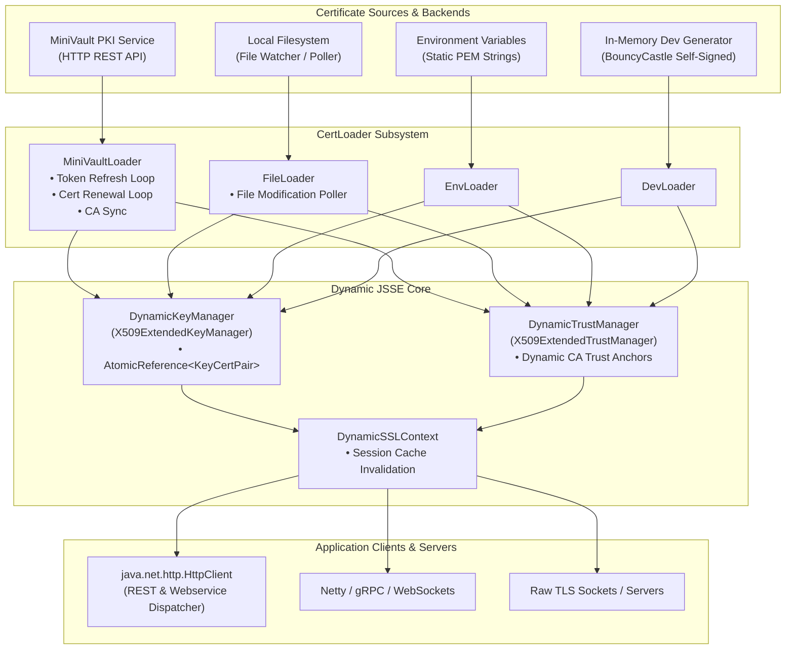
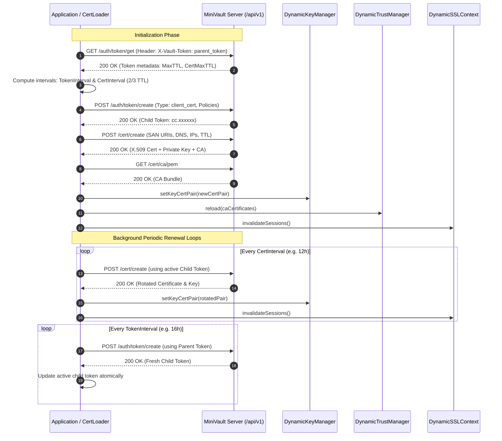
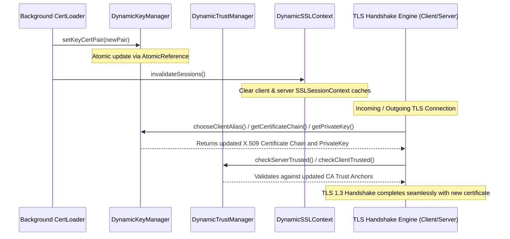

# Certificate Manager (`certmanager`)

The **Certificate Manager** (`certmanager`) module provides automated, zero-downtime certificate lifecycle management, periodic renewal, and runtime dynamic hot-reloading for X.509 client and server certificates in Java.

It provides a robust Java implementation mirroring the Go PKI ecosystems [`minivaultclient`](https://go.ub.unibas.ch/cloud/minivaultclient) and [`certloader`](https://go.ub.unibas.ch/cloud/certloader).

---

## Key Features

1. **MiniVault PKI Integration (`MiniVaultClient` & `MiniVaultLoader`)**:
   - Automated token lifecycle management (`/auth/token/get`, `/auth/token/create`).
   - Automated issuance and background rotation of short-lived X.509 certificates (`/cert/create`).
   - Dynamic fetching and synchronization of trusted Root and Intermediate CA bundles (`/cert/ca/pem`).
   - Optimal renewal scheduling (automatically derived as $\frac{2}{3}$ of token and certificate TTLs).

2. **Zero-Downtime Dynamic Hot-Reloading (`DynamicKeyManager` & `DynamicTrustManager`)**:
   - Extends standard JSSE `X509ExtendedKeyManager` and `X509ExtendedTrustManager`.
   - Rotates active client/server key pairs and updates CA trust anchors in-flight without restarting the application or re-instantiating the `SSLContext`.
   - Automatic TLS session cache invalidation upon certificate updates to enforce fresh handshakes.

3. **Pluggable Loader Backends**:
   - **`MINIVAULT`**: Cloud PKI backend for automated mutual TLS (mTLS) with token and certificate rotation.
   - **`FILE`**: Local filesystem polling for `.crt`/`.pem` and `.key` file modifications.
   - **`ENV`**: In-memory loading from environment variables or static PEM strings.
   - **`DEV`**: Ephemeral in-memory self-signed certificate generation for rapid development and testing.

---

## Architecture Overview



---

## Sequence Flows

### 1. MiniVault Token & Certificate Renewal Workflow



### 2. Runtime Certificate Hot-Reloading



---

## Usage Examples

### 1. Client-side mTLS with MiniVault

```java
import org.objectspace.certmanager.CertManager;
import org.objectspace.certmanager.config.*;
import org.objectspace.certmanager.loader.CertLoader;

import java.net.URI;
import java.net.http.HttpClient;
import java.net.http.HttpRequest;
import java.net.http.HttpResponse;
import java.time.Duration;
import java.util.List;

public class MiniVaultClientExample {
    public static void main(String[] args) throws Exception {
        MiniVaultConfig vaultConfig = MiniVaultConfig.builder()
                .baseUrl("https://vault.example.com:8200")
                .parentToken("env:VAULT_PARENT_TOKEN") // or direct token string
                .tokenType("client_cert")
                .tokenPolicies(List.of("client-policy"))
                .certType("client_cert")
                .dnss(List.of("client.example.local"))
                .uris(List.of("spiffe://example.com/client"))
                .certTtl(Duration.ofHours(24))
                .certInterval(Duration.ofHours(12))
                .useSystemPool(true)
                .build();

        CertManagerConfig config = CertManagerConfig.builder()
                .type(LoaderType.MINIVAULT)
                .vault(vaultConfig)
                .tlsMinVersion("TLSv1.3")
                .build();

        // Starts background token & certificate refresh loops
        try (CertLoader loader = CertManager.createClientLoader(config)) {
            // Get pre-configured HttpClient backed by DynamicSSLContext
            HttpClient httpClient = loader.getHttpClient();

            HttpRequest request = HttpRequest.newBuilder()
                    .uri(URI.create("https://secure-service.example.local/api/resource"))
                    .GET()
                    .build();

            HttpResponse<String> response = httpClient.send(request, HttpResponse.BodyHandlers.ofString());
            System.out.println("Status: " + response.statusCode());
        }
    }
}
```

---

### 2. Filesystem Certificate Polling (`FILE`)

```java
FileConfig fileConfig = FileConfig.builder()
        .certFile("/etc/ssl/certs/client.crt")
        .keyFile("/etc/ssl/private/client.key")
        .interval(Duration.ofMinutes(1)) // polling frequency
        .build();

try (CertLoader loader = CertManager.createFileLoader(fileConfig)) {
    SSLContext sslContext = loader.getSSLContext();
    // Pass sslContext to Netty, Apache HttpClient, Spring WebClient, etc.
}
```

---

### 3. XML Configuration Loading (`inventory.xml`)

```java
// Loads configuration automatically from XML file (e.g. inventory.xml <clienttls> section)
File configFile = new File("inventory.xml");
CertManagerConfig config = CertManager.loadConfigFromFile(configFile);

try (CertLoader loader = CertManager.createClientLoader(config)) {
    HttpClient client = loader.getHttpClient();
    // Use client for TLS/mTLS requests
}
```

---

### 4. JSON Configuration Loading

```java
String jsonConfig = """
{
    "type": "MINIVAULT",
    "initialtimeout": "30s",
    "tlsminversion": "TLSv1.3",
    "minivault": {
        "baseurl": "https://vault.example.com:8200",
        "parenttoken": "env:VAULT_PARENT_TOKEN",
        "tokentype": "client_cert",
        "tokenpolicies": ["client-policy"],
        "certtype": "client_cert",
        "dnss": ["client.example.local"],
        "certttl": "24h",
        "certinterval": "12h",
        "usesystempool": true
    }
}
""";

CertManagerConfig config = CertManager.loadConfigFromJson(jsonConfig);
CertLoader loader = CertManager.createClientLoader(config);
```

---

## Package Structure

- **`org.objectspace.certmanager`**
  - `CertManager`: Unified entry point, factory methods, and JSON deserialization.
  - **`client`**: `MiniVaultClient` REST client for communication with MiniVault endpoints.
  - **`model`**: Data transfer objects (`Token`, `TokenType`, `TokenCreateRequest`, `CertCreateRequest`, `CertResponse`, `KeyCertPair`).
  - **`ssl`**: `DynamicKeyManager`, `DynamicTrustManager`, and `DynamicSSLContext` implementing runtime hot-reload.
  - **`loader`**: `CertLoader` contract and backends (`MiniVaultLoader`, `FileLoader`, `EnvLoader`, `DevLoader`).
  - **`config`**: Strongly-typed configuration POJOs with builder patterns.
  - **`util`**: `PemUtils` (PEM parser, CA generation, X.509 converters) and `DurationParser` (Go-style `"24h"`, `"1h30m"` & ISO duration parsing).
