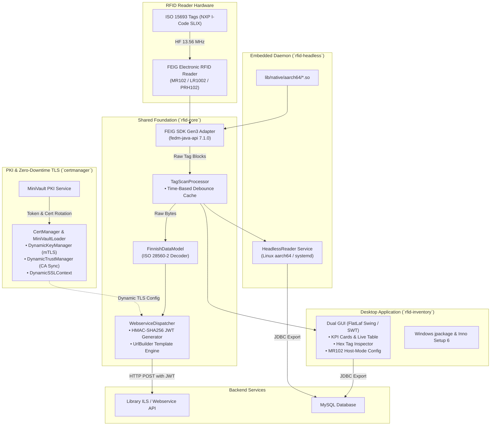

# Library RFID Tools

**Library RFID Tools** is a modernized Java-based multi-module software suite and hardware integration toolkit for library RFID management, ISO 15693 tag processing, FEIG electronic RFID reader control, and automated dynamic X.509 certificate management (MiniVault mTLS).

The system implements the **ISO 28560-2** library RFID standard ("Finnish Data Model") and integrates with the **FEIG SDK Gen3 (v7.1.0)** for high-throughput scanning, hardware diagnostic monitoring, and firmware configuration management.

---

## License & Provenance

* **Maintainer / Copyright**: Copyright 2015-2026 info-age GmbH, Basel.
* **Original System**: Based on HAWK RFID Library Tools (Copyright 2015 Center for Information, Media and Technology (ZIMT), HAWK University of Applied Sciences and Arts Hildesheim/Holzminden/Göttingen).
* **License**: GNU General Public License v3 or later (GPLv3+).

---

## System Architecture



---

## Project Modules & Repository Overview

```
Library-RFID-Tools/
├── pom.xml                                  # Root Maven multi-module POM (Java 25)
├── readme.md                                # Top-level project documentation
├── certs/                                   # Local certificates & CA store (gitignored)
├── lib/                                     # Bundled FEIG SDK Gen3 JARs & native binaries
│   ├── fedm-java-api-7.1.0.jar              # FEIG Java API (Gen3)
│   ├── fedm-funit-java-api-1.1.0.jar        # FEIG Functional Unit API
│   ├── fedm-service-java-api-11.2.1.jar     # FEIG Service API
│   ├── native/x64/                          # 64-bit Windows FEIG native driver DLLs
│   ├── native/aarch64/                      # 64-bit Linux / Raspberry Pi FEIG native driver .so
│   └── ext/                                 # Staged third-party dependency JARs
├── FEIG.ID.SDK.Gen3.Java-v7.1.0/            # Upstream FEIG Java Gen3 SDK distribution
├── FEIG.ID.SDK.Gen3.Raspi.aarch64-v7.1.0/   # FEIG Raspberry Pi aarch64 SDK distribution
├── ID_ISC.SDK.Java.Win-V5.6.3/              # Legacy FEIG SDK reference
├── certmanager/                             # Dynamic TLS Certificate Manager & MiniVault PKI Client
├── wsbrokerclient/                          # WebSocket, REST & NTP Client with dynamic mTLS for WSBroker
├── rfid-core/                               # Shared Core Module (Hardware drivers, ISO 28560, DB, Webservice)
├── rfid-inventory/                          # Desktop RFID Inventory Scanning Application (Swing/FlatLaf & SWT)
└── rfid-headless/                           # Headless Continuous RFID Daemon for Raspberry Pi (aarch64)
```

---

## Modules

### 1. [Certificate Manager](certmanager/readme.md) (`certmanager`)
Automated dynamic certificate management, token lifecycle management, and zero-downtime hot-reloading for client and server certificates in Java:
* **MiniVault PKI Integration**: Automatic token renewal (`/auth/token/get`, `/auth/token/create`), certificate issuance (`/cert/create`), and CA synchronization (`/cert/ca/pem`).
* **Dynamic JSSE Components**: Custom `DynamicKeyManager`, `DynamicTrustManager`, and `DynamicSSLContext` enabling certificate rotation without restarting the JVM or re-creating network clients.
* **Pluggable Backends**: MiniVault PKI, local file polling (`FILE`), environment variables (`ENV`), and in-memory self-signed generation (`DEV`).

### 2. [WSBroker Client](wsbrokerclient/readme.md) (`wsbrokerclient`)
Asynchronous WebSocket, REST, and NTP client library for WSBroker event routing with zero-downtime dynamic mTLS:
* **WebSocket Pub/Sub & Remote Actions**: Thread-safe event routing, auto-reconnect with exponential backoff, automated ping/pong heartbeats, and typed payload handling.
* **Dynamic mTLS via `certmanager`**: Seamless integration with `CertLoader` for automatic client certificate rotation and CA trust updates.
* **NTP over WebSocket Time Sync**: RFC 5905 48-byte NTP synchronization over WebSocket with clock offset and round-trip latency calculations.
* **REST Management API**: Dispatches events to channels and manages remote subscribers via HTTP REST endpoints.
* **Native GUI Demo (`WSChat`)**: Complete desktop GUI client demo application with FlatLaf modern UI, dark/light theme, KPI metrics cards, dynamic channel joining, and live event console matching `wschat.xml`.

### 3. [RFID Core](rfid-core/readme.md) (`rfid-core`)
The headless foundation module shared by desktop and embedded applications:
* **FEIG Reader Integration**: `FeigRFID`, `ISO15693Feig`, `ISO15693ReaderFactory` wrapping FEIG SDK Gen3 APIs.
* **Data Model**: ISO 28560 / Finnish Data Model encoding/decoding (`FinnishDataModel`, `FinnishDataModelOptionalBlock`).
* **Processing & Dispatching**: `TagScanProcessor`, `WebserviceDispatcher`, HMAC-SHA256 `JwtGenerator`, and dynamic `UrlBuilder`.

### 4. [RFID Inventory](rfid-inventory/readme.md) (`rfid-inventory`)
Desktop inventory scanning tool for ISO 15693 RFID tags.
* **Dual UI**: Modern Swing / FlatLaf interface with Dark/Light theme support, live search, KPI metrics cards, tag inspector, and hex dump analysis, or classic SWT native UI.
* **Data Logging**: Real-time export to SQL databases (MySQL/MariaDB) or RESTful webservices with HMAC-SHA256 JWT authorization, plus CSV export.
* **Hardware & Firmware Management**: Built-in scripts to backup and restore full EEPROM/RAM hardware parameter sets on FEIG readers (`backup-firmware.ps1`, `restore-firmware.ps1`).
* **Packaging**: Self-contained Windows runtime packaging (`jpackage`) and Inno Setup installer generator (`build-installer.ps1`).

### 5. [RFID Headless](rfid-headless/README.md) (`rfid-headless`)
Lightweight, headless daemon for Raspberry Pi 4 / 5 (Linux aarch64):
* **No UI Required**: Runs fully automated as a CLI tool or background systemd service without GUI dependencies.
* **Immediate Autonomous Scanning**: Automatically discovers connected FEIG USB readers, initiates scanning immediately upon startup, and auto-reconnects on hardware disconnections.
* **Time-Based Debounce**: Built-in configurable cooldown (default: 3000 ms) to suppress repetitive events while tags linger in the antenna field.
* **Native aarch64 Support**: Fully integrated with FEIG Gen3 Linux aarch64 `.so` libraries.

---

## Technical Stack & Dependencies

* **Language & Runtime**: Java 25 (LTS compatibility with `--release 25`)
* **Cryptography & PKI**: BouncyCastle (bcprov 1.79, bcpkix 1.79) & Jackson (2.18.2)
* **RFID Hardware SDK**: FEIG SDK Gen3 for Java (v7.1.0) with x64 & aarch64 native driver binaries
* **UI Frameworks**:
  * [FlatLaf 3.5.4](https://www.formdev.com/flatlaf/) for modern responsive Swing GUI
  * Eclipse SWT (Standard Widget Toolkit, Windows x64) for classic interface
* **Configuration & Utilities**: Apache Commons (Configuration2 2.10.1, Collections4 4.4, Lang3 3.17.0)
* **Logging**: SLF4J 2.0.16 & Logback 1.5.12
* **Database Driver**: MySQL Connector/J 8.4.0 LTS
* **Testing**: JUnit 5 (Jupiter 5.10.2) & AssertJ (3.25.3)

---

## Prerequisites

* **Operating System**: Windows 10 / 11 (x64) or Linux (aarch64 / x86_64)
* **Java Development Kit**: JDK 25 or later (with `JAVA_HOME` environment variable configured)
* **Maven**: Apache Maven 3.9+ (or an IDE with integrated Maven support)
* **Inno Setup 6** *(optional)*: Required only when compiling the Windows installation package (`.exe`)

---

## Building the Project

From the project root:

```bash
# Compile and run test suite across all modules
mvn clean test

# Build package artifacts
mvn clean package
```

### Running Tests

Execute tests with Maven or via the standalone test runner:

```powershell
# Run the standalone TestRunner across all test suites
java -cp "rfid-inventory\target\classes;rfid-inventory\target\test-classes;lib\*;lib\ext\*" org.objectspace.rfid.TestRunner
```

---

## Quick Start: RFID Inventory (Desktop)

To start the RFID Inventory application directly from the source repository:

```powershell
cd rfid-inventory
.\run-inventory.ps1
```

To build a standalone Windows setup installer:

```powershell
cd rfid-inventory
.\build-installer.ps1 -AppVersion "1.0.6"
```

---

## Quick Start: RFID Headless (Raspberry Pi / Linux aarch64)

### Building the Distribution Package

To build the self-contained Linux aarch64 distribution package (`.tar.gz` and `.zip`):

```powershell
# From project root:
.\build-rfid-headless-dist.ps1

# Or from rfid-headless directory:
cd rfid-headless
.\build-dist.ps1
```

Output artifacts:
* `dist/rfid-headless-2.0.0-SNAPSHOT-linux-aarch64.tar.gz`
* `dist/rfid-headless-2.0.0-SNAPSHOT-linux-aarch64.zip`

### Deployment & Execution on Raspberry Pi

Extract the archive on the Raspberry Pi (e.g. to `/opt/rfid-headless`):

```bash
# Extract package
sudo mkdir -p /opt/rfid-headless
sudo chown -R $USER:$USER /opt/rfid-headless
tar -xzf rfid-headless-2.0.0-SNAPSHOT-linux-aarch64.tar.gz -C /opt/
cd /opt/rfid-headless
chmod +x run-rfid-headless.sh lib/native/aarch64/*.sh lib/native/aarch64/*.so*

# Direct startup using run script
./run-rfid-headless.sh

# Custom debounce (5 seconds) and scan cycle interval (200 ms)
./run-rfid-headless.sh -c inventory.xml --debounce 5000 --sleep 200
```

To install as a persistent background `systemd` service:

```bash
sudo cp rfid-headless.service /etc/systemd/system/
sudo systemctl daemon-reload
sudo systemctl enable rfid-headless.service
sudo systemctl start rfid-headless.service
```
