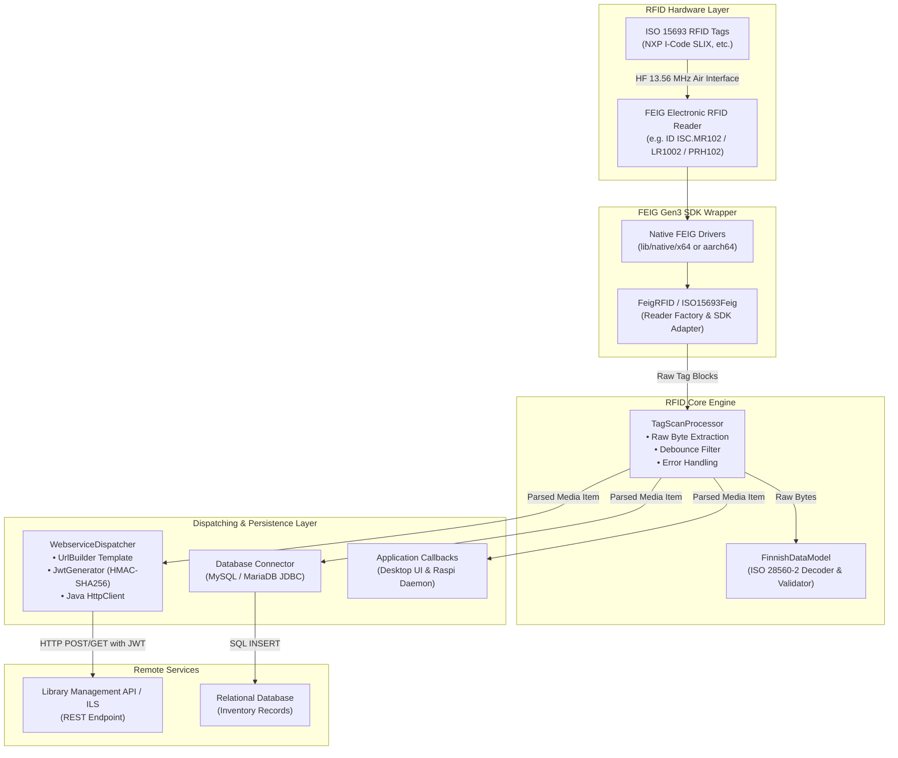
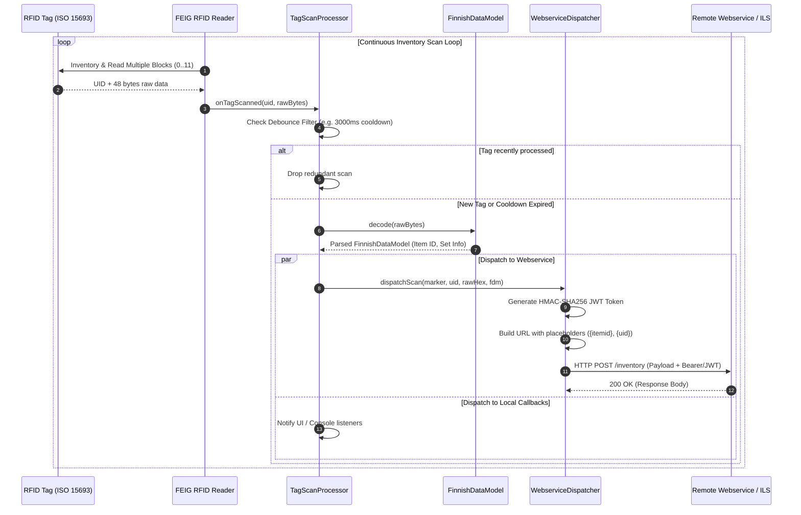
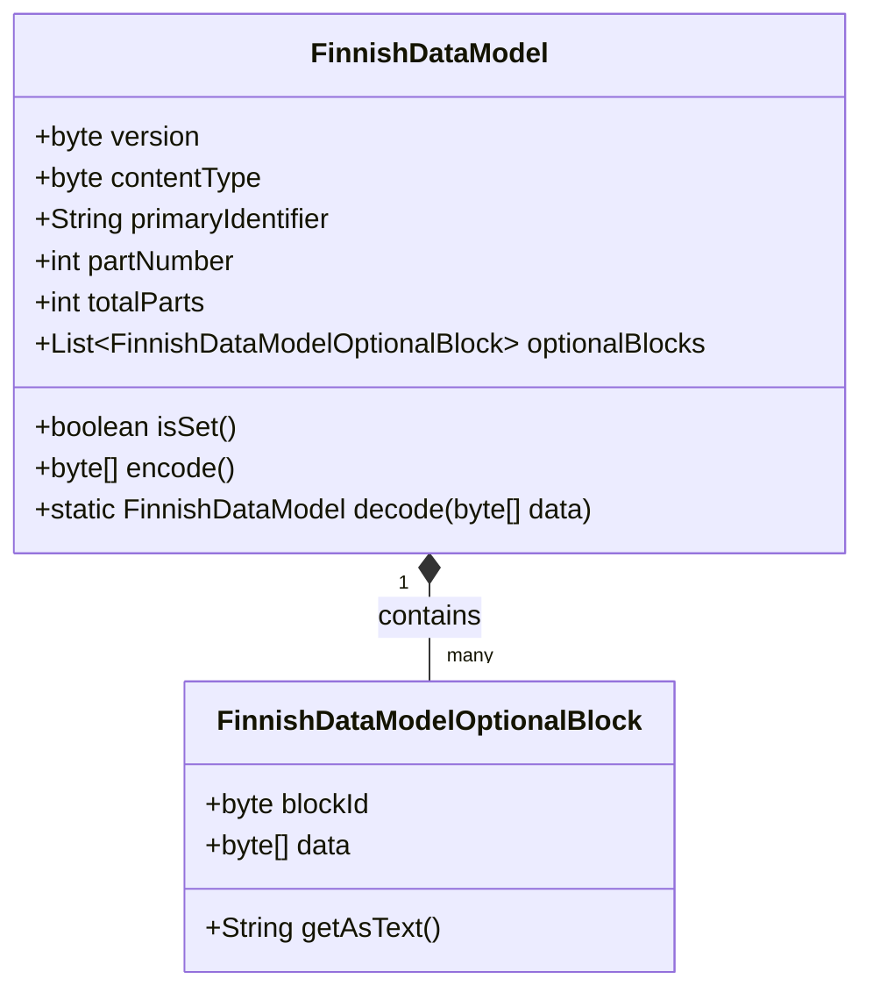

# RFID Core (`rfid-core`)

The **RFID Core** (`rfid-core`) module provides the headless, foundational infrastructure for RFID hardware abstraction (FEIG electronic Gen3 SDK), the ISO 28560-2 library data model ("Finnish Data Model"), tag validation pipelines, and RESTful webservice dispatching.

---

## Key Features

1. **ISO 28560-2 / Finnish Data Model (`FinnishDataModel`)**:
   - High-throughput bitwise encoding and decoding of standard library RFID tags.
   - Parses Primary Item Identifiers (barcodes / signatures), Content Parameters, Type of Usage, Format Versions, and Optional Blocks (Set Information, Title / Call Number extensions).
2. **FEIG SDK Gen3 Hardware Integration (`org.objectspace.rfid.feig`)**:
   - Comprehensive abstraction wrapping FEIG SDK Gen3 (`fedm-java-api-7.1.0.jar`, `fedm-funit-java-api-1.1.0.jar`, `fedm-service-java-api-11.2.1.jar`).
   - Supports ISO 15693 High-Frequency (HF) readers via USB, Serial, and TCP/IP interfaces with automatic reconnection handling.
3. **Tag Scanning & Pipeline Processor (`TagScanProcessor`)**:
   - Decoupled event-driven scanning pipeline with configurable time-based debounce filters.
   - Synchronous or asynchronous fan-out to local GUI callbacks, SQL databases, and remote webservices.
4. **RESTful Webservice Dispatcher with HMAC-SHA256 JWT Authorization (`WebserviceDispatcher`)**:
   - Formulates dynamic HTTP GET/POST payloads with template URL placeholders (`{marker}`, `{session}`, `{uid}`, `{raw}`, `{itemid}`, `{clientid}`).
   - Secure HMAC-SHA256 JWT authorization token generation matching the Android NFC Reader protocol.

---

## Architecture & Data Flow



---

## Tag Processing & Webservice Dispatch Sequence



---

## ISO 28560-2 / Finnish Data Model Memory Layout



---

## Usage Examples

### 1. Decoding ISO 28560-2 Tag Data

```java
import org.objectspace.rfid.FinnishDataModel;

byte[] tagBytes = getRawTagData(); // 48 bytes read from blocks 0..11
FinnishDataModel model = FinnishDataModel.decode(tagBytes);

if (model != null) {
    System.out.println("Item Identifier (Barcode): " + model.getPrimaryIdentifier());
    System.out.println("Part Number: " + model.getPartNumber() + " of " + model.getTotalParts());
    System.out.println("Content Type: " + model.getContentType());
}
```

---

### 2. Webservice Dispatching with Dynamic URL and JWT

```java
import org.objectspace.rfid.webservice.WebserviceConfig;
import org.objectspace.rfid.webservice.WebserviceDispatcher;
import org.objectspace.rfid.webservice.WebserviceResponse;

WebserviceConfig config = new WebserviceConfig();
config.setActive(true);
config.setTargetUrl("https://inventory.example.org/api/v1/scan?clientid={clientid}");
config.setHttpMethod("POST");
config.setJwtKey("secret-hmac-key");
config.setClientId("station-01");

WebserviceDispatcher dispatcher = new WebserviceDispatcher(config);

WebserviceResponse response = dispatcher.dispatchScan(
        "shelf-A3",          // marker/location
        null,                // userText
        "Item 12345",        // nfcContent
        "E004015099887766",  // rawPayloadHex
        "E004015099887766",  // uid
        model,               // FinnishDataModel
        "session-987",       // session id
        "FEIG_MR102"         // deviceName
);

System.out.println("Dispatch status: " + response.getStatusCode());
System.out.println("Response payload: " + response.getBody());
```
