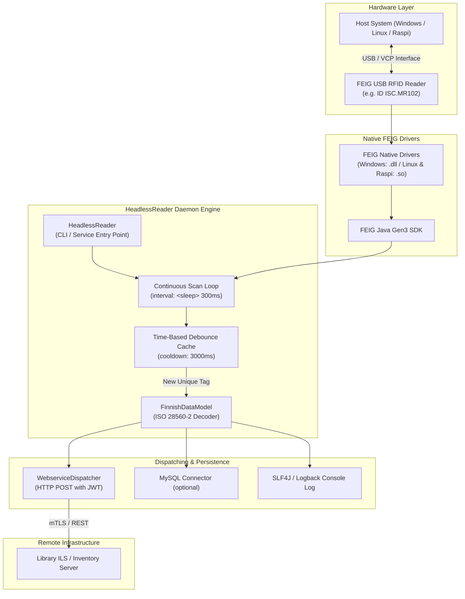

# RFID Headless - Continuous RFID Daemon

**RFID Headless** (formerly Raspi Inventory) is a lightweight, autonomous background RFID daemon for Linux (x64), Windows (x64), and Raspberry Pi 4 / 5 (Linux `aarch64`), designed to control FEIG Electronic RFID readers (USB) and continuously scan, validate, and dispatch library media items (ISO 15693 / ISO 28560-2).

---

## Key Features

* **Cross-Platform Operation**: Native distribution packages and run scripts for Windows (x64), Linux (x64), and Raspberry Pi (aarch64).
* **Targeted FEIG SDK Integration**:
  * **Windows & Linux (x64)**: Uses `FEIG.ID.SDK.Gen3.Java-v7.1.0` with 64-bit DLLs and shared `.so` libraries.
  * **Raspberry Pi (aarch64)**: Uses `FEIG.ID.SDK.Gen3.Raspi.aarch64-v7.1.0` with 64-bit ARM Linux `.so` libraries.
* **Headless Autonomous Operation**: Runs out-of-the-box as a CLI tool, batch daemon, or managed `systemd` background service without graphical dependencies.
* **Continuous Scanning & Time-Based Debouncing**: Continuously queries the reader field and suppresses redundant event bursts using a configurable debounce cooldown window (default: 3000 ms), coupled with an independent Active Tag Presence Cache for intelligent inbound write command routing. See [Cache Architecture Documentation](cache-architecture.md).
* **Automatic Hardware Discovery & Auto-Reconnect**: Seamlessly re-establishes connection on USB disconnects or power cycles without daemon restarts.
* **REST Webservice & Client TLS Integration**: Dispatches scan events in real-time with HMAC-SHA256 JWT authorization tokens and dynamic TLS.
* **WebSocket & WSBroker Integration**: Real-time bidirectional event streaming and remote reader hardware querying (`rfid:tag_read`, `rfid:get_device_metadata`, etc.) with mTLS / MiniVault support. See [WebSocket Documentation](websocket.md).

---

## Daemon Architecture & Scanning Flow



---

## 1. Building Distribution Packages (`build-dist`)

Build self-contained distribution packages for Windows, Linux, and Raspberry Pi:

```powershell
# Build for all target platforms (Windows, Linux, Raspi)
.\build-dist.ps1 -Target all

# Build specifically for Windows (x64)
.\build-dist.ps1 -Target windows

# Build specifically for Linux (x64)
.\build-dist.ps1 -Target linux

# Build specifically for Raspberry Pi (aarch64)
.\build-dist.ps1 -Target raspi
```

### Output Packages:
* **Windows (x64)**: `dist/rfid-headless-2.0.0-SNAPSHOT-windows-x64.zip` (Uses `FEIG.ID.SDK.Gen3.Java-v7.1.0`)
* **Linux (x64)**: `dist/rfid-headless-2.0.0-SNAPSHOT-linux-x64.tar.gz` and `.zip` (Uses `FEIG.ID.SDK.Gen3.Java-v7.1.0`)
* **Raspberry Pi (aarch64)**: `dist/rfid-headless-2.0.0-SNAPSHOT-raspi-aarch64.tar.gz` and `.zip` (Uses `FEIG.ID.SDK.Gen3.Raspi.aarch64-v7.1.0`)

---

## 2. Running RFID Headless (`run`)

### On Windows:
Using PowerShell:
```powershell
.\run-rfid-headless.ps1
# With custom config or options:
.\run-rfid-headless.ps1 -c inventory.xml --debounce 5000
```

### On Linux (x64):
```bash
./run-rfid-headless.sh --target linux
# Or direct auto-detection:
./run-rfid-headless.sh -c inventory.xml
```

### On Raspberry Pi (aarch64):
```bash
./run-rfid-headless.sh --target raspi
# Or direct auto-detection:
./run-rfid-headless.sh -c inventory.xml --debounce 5000 --sleep 200
```

---

## 3. Configuration (`inventory.xml`)

The `inventory.xml` file configures the RFID reader interface, scan parameters, and remote dispatching:

```xml
<configuration>
    <!-- RFID Reader Settings -->
    <device>
        <select>feig</select>
        <feig>
            <type>usb</type>
        </feig>
    </device>

    <!-- Webservice connection (optional) -->
    <webservice>
        <active>true</active>
        <client_id>raspi-station-01</client_id>
        <target_url><![CDATA[https://inventory.example.org/api/inventory?clientid={clientid}]]></target_url>
        <http_method>POST</http_method>
        <jwt_key><![CDATA[secret-jwt-key]]></jwt_key>
        <debug_mode>false</debug_mode>
    </webservice>

    <!-- Scan cycle interval in milliseconds -->
    <inventory>
        <sleep>300</sleep>
    </inventory>
</configuration>
```

---

## 4. WebSocket & WSBroker Integration

`rfid-headless` provides high-performance WebSocket streaming to **WSBroker** for broadcasting tag events and handling remote reader inspection commands.

```xml
    <!-- WSBroker WebSocket Connection (optional) -->
    <wsbroker>
        <active>true</active>
        <name>rfid-reader-station-01</name>
        <url><![CDATA[https://localhost:8765]]></url>
        <channels>
            <channel>all</channel>
            <channel>intern</channel>
        </channels>
        <clienttls>
            <type>minivault</type>
            ...
        </clienttls>
    </wsbroker>
```

For complete documentation on event formats, query commands, request-reply flows, and integration examples in Java, Go, and JavaScript, please refer to the dedicated documentation:

👉 **[WebSocket & WSBroker Integration Documentation (`websocket.md`)](websocket.md)**

---

## 5. Systemd Service Setup (Linux & Raspberry Pi)

To install and run `rfid-headless` as a background systemd service:

```bash
sudo cp rfid-headless.service /etc/systemd/system/
sudo systemctl daemon-reload
sudo systemctl enable rfid-headless.service
sudo systemctl start rfid-headless.service

# View live daemon logs
sudo journalctl -u rfid-headless -f
```
