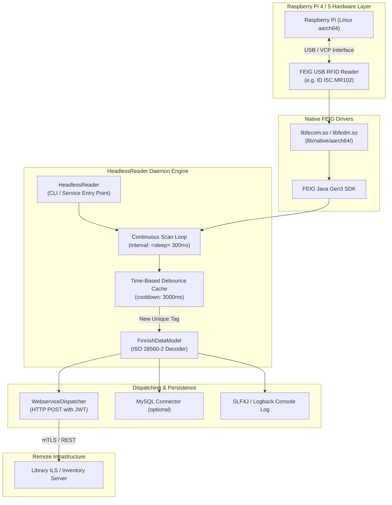
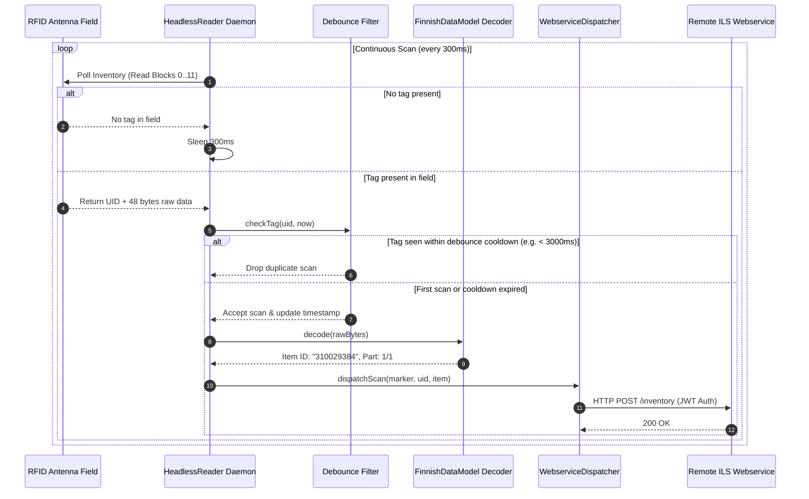

# RFID Headless - Continuous RFID Daemon

**RFID Headless** (formerly Raspi Inventory) is a lightweight, autonomous background RFID daemon for Raspberry Pi 4 and 5 (Linux `aarch64`), designed to control FEIG Electronic RFID readers (USB) and continuously scan, validate, and dispatch library media items (ISO 15693 / ISO 28560-2).

---

## Key Features

* **Headless Autonomous Operation**: Runs out-of-the-box as a CLI tool or managed `systemd` background service without graphical dependencies.
* **Continuous Scanning & Time-Based Debouncing**: Continuously queries the reader field and suppresses redundant event bursts using a configurable debounce cooldown window (default: 3000 ms).
* **Automatic Hardware Discovery & Auto-Reconnect**: Seamlessly re-establishes connection on USB disconnects or power cycles without daemon restarts.
* **REST Webservice & Client TLS Integration**: Dispatches scan events in real-time with HMAC-SHA256 JWT authorization tokens and dynamic TLS.
* **Native 64-bit ARM Support**: Fully integrated with FEIG Gen3 Linux aarch64 native libraries (`lib/native/aarch64/*.so`).

---

## Daemon Architecture & Scanning Flow



---

## Continuous Scan & Debounce Sequence



---

## 1. System Requirements (Raspberry Pi)

* **Hardware**: Raspberry Pi 4 / 5 (64-bit OS / `aarch64`)
* **Operating System**: Raspberry Pi OS 64-bit (Debian Bookworm or Bullseye)
* **Java Runtime**: OpenJDK 21 or OpenJDK 25 (Headless JRE is sufficient):
  ```bash
  sudo apt update
  sudo apt install -y openjdk-21-jre-headless
  ```
* **Hardware Permissions**: The running user must belong to `plugdev` or `dialout` groups for USB access.

---

## 2. Installation

Extract the distribution package to `/opt/rfid-headless`:

```bash
# Create target directory
sudo mkdir -p /opt/rfid-headless
sudo chown -R $USER:$USER /opt/rfid-headless

# Extract distribution archive
tar -xzf rfid-headless-2.0.0-SNAPSHOT-linux-aarch64.tar.gz -C /opt/
# or
unzip rfid-headless-2.0.0-SNAPSHOT-linux-aarch64.zip -d /opt/

cd /opt/rfid-headless
chmod +x run-rfid-headless.sh lib/native/aarch64/*.sh lib/native/aarch64/*.so*
```

---

## 3. Configuration (`inventory.xml`)

The `inventory.xml` file configures the RFID reader interface, scan parameters, and remote dispatching:

```xml
<configuration>
    <!-- RFID Reader Settings -->
    <device>
        <select>feig</select>
        <feig>
            <type>usb</type>
        </feig>
    </device>

    <!-- Webservice connection (optional) -->
    <webservice>
        <active>true</active>
        <client_id>raspi-station-01</client_id>
        <target_url><![CDATA[https://inventory.example.org/api/inventory?clientid={clientid}]]></target_url>
        <http_method>POST</http_method>
        <jwt_key><![CDATA[secret-jwt-key]]></jwt_key>
        <debug_mode>false</debug_mode>
    </webservice>

    <!-- Client TLS / mTLS configuration with dynamic certificate loading -->
    <clienttls>
        <type>minivault</type>
        <minivault>
            <baseurl><![CDATA[https://localhost:8759/api/v1]]></baseurl>
            <parenttoken><![CDATA[pa.22f09dfd1cbfbe9f.c17b29cb2b730533]]></parenttoken>
            <tokentype>client_cert</tokentype>
            <tokenpolicies>
                <policy>wsbroker.client</policy>
            </tokenpolicies>
            <certtype>client_cert</certtype>
            <uris>
                <uri>wsbroker:client:display01</uri>
            </uris>
            <ca>
                <path>certs/minivault.ca.pem</path>
            </ca>
            <usesystempool>false</usesystempool>
        </minivault>
    </clienttls>

    <!-- Scan cycle interval in milliseconds -->
    <inventory>
        <sleep>300</sleep>
    </inventory>
</configuration>
```

---

## 4. Manual Execution

Run the daemon via the startup script:

```bash
# Standard startup (reads inventory.xml from current directory)
./run-rfid-headless.sh

# With explicit configuration file
./run-rfid-headless.sh -c /opt/rfid-headless/inventory.xml

# Custom debounce (5s) and scan cycle interval (200ms)
./run-rfid-headless.sh -c inventory.xml --debounce 5000 --sleep 200

# Enable debug logging
./run-rfid-headless.sh --debug
# or via environment variable
LOG_LEVEL=DEBUG ./run-rfid-headless.sh
```

### Command Line Options:
* `-c, --config <file>`: Path to `inventory.xml` (default: `inventory.xml`)
* `-d, --debounce <ms>`: Debounce cooldown window in ms (default: `3000`)
* `-s, --sleep <ms>`: Pause between scan loops in ms (default: `300`)
* `-b, --blocks <num>`: Number of ISO 15693 blocks to read (default: `12`)
* `--debug`: Enable verbose DEBUG log output
* `--remote-debug`: Enable JVM remote debugging on port 5005
* `-v, --version`: Print version information
* `-h, --help`: Display help and usage information

---

## 5. Systemd Background Service Setup

To enable auto-start on Raspberry Pi boot:

```bash
# Copy systemd unit file
sudo cp /opt/rfid-headless/rfid-headless.service /etc/systemd/system/

# Reload systemd daemon
sudo systemctl daemon-reload

# Enable and start service
sudo systemctl enable rfid-headless.service
sudo systemctl start rfid-headless.service

# Check service status and live logs
sudo systemctl status rfid-headless.service
sudo journalctl -u rfid-headless.service -f
```
