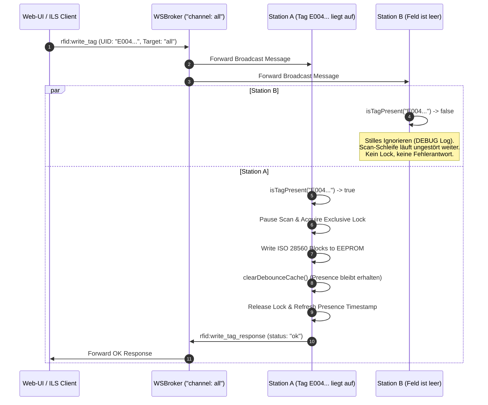

# RFID Headless - Cache-Architektur: Debounce-Cache & Tag-Presence-Cache

In `rfid-headless` erfüllen der **Debounce-Cache** (`lastSeenMap`) und der **Tag-Presence-Cache** (`activePresenceMap`) zwei grundlegend unterschiedliche, voneinander entkoppelte Aufgaben. Diese strikte Trennung maximiert die Gesamteffizienz des Systems: Sie eliminiert unnötige Netzwerk- und Lock-Belastungen bei Multi-Reader-Installationen, verhindert Event-Stürme und stellt sicher, dass Schreiboperationen ohne Latenz oder Race Conditions ausgeführt werden können.

```
┌─────────────────────────────────────────────────────────────────────────────────┐
│                          ISO15693 Hardware Reader Field                         │
│                    (Scan-Zyklus alle ~300 ms via ISO15693Feig)                  │
└────────────────────────────────────────┬────────────────────────────────────────┘
                                         │
                                   doIt(uid, data)
                                         │
                 ┌───────────────────────┴───────────────────────┐
                 │                                               │
                 ▼                                               ▼
   ┌───────────────────────────┐                   ┌───────────────────────────┐
   │     Tag-Presence-Cache    │                   │       Debounce-Cache      │
   │    (`activePresenceMap`)  │                   │       (`lastSeenMap`)     │
   ├───────────────────────────┤                   ├───────────────────────────┤
   │ Zweck: Physische Präsenz  │                   │ Zweck: Event-Drosselung   │
   │ TTL: kurz (~1200 ms)      │                   │ Cooldown: lang (~3000 ms) │
   │ Aktualisierung: JEDER Scan│                   │ Reset: Nach Writes / Clear│
   └─────────────┬─────────────┘                   └─────────────┬─────────────┘
                 │                                               │
                 ▼                                               ▼
   ┌───────────────────────────┐                   ┌───────────────────────────┐
   │ Filter für Inbound Writes │                   │ Outbound Event Dispatch   │
   │ (`write_tag`, `write_afi`)│                   │ (WSBroker / REST / DB)    │
   └───────────────────────────┘                   └───────────────────────────┘
```

---

## 1. Der Debounce-Cache (`lastSeenMap`)

### Zweck & Funktionsweise
Der Debounce-Cache steuert ausschließlich das **ausgehende Event-Dispatching** (`rfid:tag_read`, Webservice-POST, DB-Persistierung). Wenn ein Buch oder Medium dauerhaft auf der Antenne verweilt, würde der Reader bei jedem Scanzyklus (alle 300 ms) dasselbe Tag erneut einlesen, decodieren und als Event versenden. Dies würde unproduktive CPU-Zyklen verbrauchen und die nachgelagerte Netzwerkinfrastruktur überlasten.

* **Speicherstruktur**: `ConcurrentHashMap<String, Long>` (Schlüssel: normalisierte `UID`, Wert: Timestamp des letzten erfolgreichen Dispatches).
* **Cooldown-Zeitfenster (`debounceMillis`)**: Standardmäßig `3000 ms` (konfigurierbar über `<debounce>` in `inventory.xml` oder CLI-Parameter `--debounce`).
* **Entscheidungslogik in `HeadlessReaderCallback.doIt(...)`**:
  ```java
  Long lastSeen = !normalizedUid.isEmpty() ? lastSeenMap.get(normalizedUid) : null;
  if (lastSeen != null && (now - lastSeen) < debounceMillis) {
      debouncedScans.incrementAndGet();
      return null; // Event-Dispatching unterdrücken
  }
  // Erst nach Ablauf des Cooldowns: ISO 28560 decodieren und dispatchen
  lastSeenMap.put(normalizedUid, now);
  ```

### Lebenszyklus & Reset
* **Bei leerem Feld (`empty()`)**: Wird das Antennenfeld geräumt (0 Tags gemeldet), wird `lastSeenMap.clear()` ausgeführt, sodass ein neu aufgelegtes Medium sofort beim ersten Scan erfasst und gemeldet wird.
* **Nach Schreibvorgängen (`clearDebounceCache()`)**: Sobald neue Daten oder ein neuer AFI-Status auf das Tag geschrieben wurden, wird gezielt nur der Debounce-Cache geleert. Der nächste Scanzyklus liest das Tag unmittelbar ein und publiziert den neuen Stand per WebSocket/REST.

---

## 2. Der Tag-Presence-Cache (`activePresenceMap`)

### Zweck & Funktionsweise
Der Tag-Presence-Cache verfolgt die **tatsächliche physische Anwesenheit** von RFID-Transpondern auf der Antenne. Er dient primär als schneller In-Memory-Filter für eingehende Schreibbefehle (`rfid:write_tag`, `rfid:write_afi`), die über geteilte Broadcast-Kanäle (`all`, `intern`) an alle Stationen gesendet werden.

* **Speicherstruktur**: `ConcurrentHashMap<String, Long>` (Schlüssel: normalisierte `UID`, Wert: Timestamp der letzten physischen Hardware-Erkennung).
* **Sliding-Window TTL (`presenceTtlMillis`)**: Standardmäßig `1200 ms` (`DEFAULT_PRESENCE_TTL_MILLIS`). Dies entspricht etwa 3 bis 4 Scan-Intervallen.
* **Aktualisierung**: Jeder Hardware-Treffer in `doIt(...)` aktualisiert den Zeitstempel in `activePresenceMap` **immer**, selbst wenn das Tag für ausgehende Events im Debounce-Cooldown ist.
* **Präsenzprüfung (`isTagPresent(uid)`)**:
  ```java
  public boolean isTagPresent(String uid) {
      if (uid == null || uid.trim().isEmpty()) return false;
      String normalizedUid = uid.trim();
      Long lastSeen = activePresenceMap.get(normalizedUid);
      if (lastSeen == null) return false;
      long now = System.currentTimeMillis();
      boolean present = (now - lastSeen) <= presenceTtlMillis;
      if (!present) {
          activePresenceMap.remove(normalizedUid, lastSeen);
      }
      return present;
  }
  ```

### HF-Glitches & Sliding-Window-Toleranz
In realen RFID-Umgebungen treten gelegentlich kurzzeitige Funkunterbrechungen auf (z. B. durch elektromagnetische Einstreuungen oder ungünstige Tag-Winkel). Durch das 1200ms-Zeitfenster bleibt der Transponder auch dann als präsent registriert, wenn ein einzelner 300ms-Hardware-Scanzyklus fehlschlägt.

### Atomare Feldräumung (`empty()`)
Sobald der FEIG-Treiber `0` Tags im Feld erkennt, ruft die Scan-Schleife `callback.empty()` auf. Dadurch wird `activePresenceMap.clear()` sofort atomar ausgeführt. Broadcast-Schreibbefehle werden ab diesem Moment unverzüglich ignoriert.

---

## 3. Zusammenspiel beim Channel-Routing von Schreibbefehlen

Wenn ein Client einen Schreibbefehl über WSBroker sendet, verhindert der Presence-Cache unnötige Blockaden und Fehlermeldungen im Gesamtsystem:



### Routing-Regeln im `HeadlessWsBrokerDispatcher`
1. **Broadcast-Befehle (`target != clientName`)**:
   - Ist die angeforderte UID nicht im Presence-Cache der Station vorhanden, wird der Befehl mit einem `DEBUG`-Logeintrag ignoriert.
   - Es wird kein Hardware-Lock angefordert und keine störende Fehlerantwort an den Broadcast-Kanal gesendet.
2. **Unicast-Direktbefehle (`target == clientName`)**:
   - Ist die Station explizit adressiert, aber das Tag fehlt, wird sofort eine Fehlermeldung (`status: error`, `"Tag not present on reader station"`) zurückgegeben, ohne erst zeitaufwändig die Scan-Schleife zu blockieren.
3. **Wildcard-Schreibbefehle (`uid` leer oder `*`)**:
   - Ein Wildcard-Schreibbefehl wird bei Broadcasts nur dann ausgeführt, wenn exakt **1** Tag auf der Antenne liegt (`callback.getPresentTagCount() == 1`). Liegen 0 oder mehrere Medien auf, wird der Broadcast ignoriert, um Fehlprogrammierungen zu verhindern.
4. **Verkettete Schreibvorgänge (Chained Writes)**:
   - Nach dem Schreiben von Metadaten (`rfid:write_tag`) wird nur der Debounce-Cache über `clearDebounceCache()` geleert, während die Präsenz aktiv bleibt. Ein unmittelbar darauffolgender `rfid:write_afi`-Befehl wird somit ohne Verzögerung sofort ausgeführt.

---

## 4. Direkter Vergleich

| Eigenschaft | Debounce-Cache (`lastSeenMap`) | Tag-Presence-Cache (`activePresenceMap`) |
| :--- | :--- | :--- |
| **Hauptaufgabe** | Unterdrückung redundanter ausgehender Scan-Events | Filterung & Routing eingehender Schreibbefehle |
| **Datenrichtung** | Outbound (`rfid:tag_read`, REST-POST, DB) | Inbound (`rfid:write_tag`, `rfid:write_afi`) |
| **Zeitfenster (TTL)** | Lang (`3000 ms` bis `30000 ms`) | Kurz (`1200 ms`, ca. 3–4 Scanzyklen) |
| **Aktualisierung** | Nur nach Ablauf des Cooldowns bei neuem Dispatch | Bei **jedem** einzelnen Hardware-Scanzyklus |
| **Reset nach Schreibbefehl** | **Wird geleert** (`clearDebounceCache()`), damit neue Daten sofort gemeldet werden | **Bleibt erhalten**, damit Folgeoperationen (z. B. AFI-Setzen) sofort greifen |
| **Reset bei leerem Feld** | Wird sofort geleert (`empty()`) | Wird sofort geleert (`empty()`) |
| **Systemnutzen** | Spart Bandbreite, CPU und Datenbank-I/O | Verhindert Reader-Lock-Konflikte und Fehlermeldungs-Stürme bei Broadcasts |
