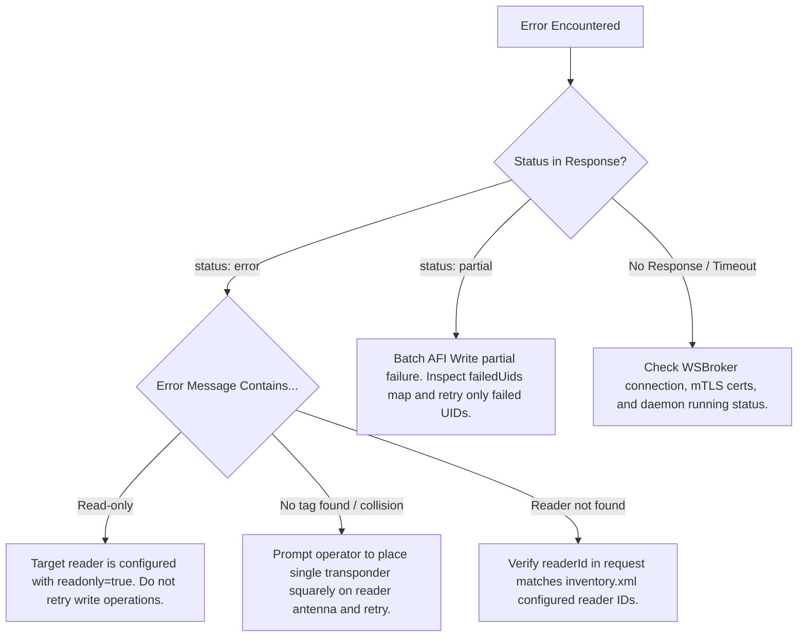

# RFID Headless WebSocket & WSBroker AI Agent Skill

## 1. Overview & System Purpose

`rfid-headless` is a headless background Java daemon that interfaces with FEIG Electronic HF RFID reader hardware (ISO 15693) to read and write library transponders following the **ISO 28560-2** data standard (item barcode, ISIL library code, country code, part numbering, CRC checksum, and security AFI byte).

The daemon connects as a WebSocket client to a **WSBroker** server. It operates bi-directionally:
1. **Autonomous Outbound Broadcasts**: Continuously monitors the reader RF field and broadcasts real-time transponder scan events (`rfid:tag_read`) and plate clearance / disconnect events (`rfid:tags_cleared`) to configured WSBroker channels (`all`, `intern`, reader-specific channels).
2. **Inbound Command Execution & Responses**: Receives JSON command messages (device diagnostics query, transponder block writing, AFI byte security toggling), executes them on the targeted reader instance, and returns correlated response events (`refId`).

---

## 2. When to Use This Skill

Use this skill whenever an AI agent, autonomous controller, or client application needs to:
- Subscribe to and decode real-time RFID transponder scan streams from `rfid-headless`.
- Track presence and removal of physical media items on RFID reader antennas.
- Query reader hardware status, firmware versions, and startup diagnostics.
- Write ISO 28560-2 metadata or program AFI security bytes (check-in / check-out / EAS) to single or batch RFID tags.
- Target specific readers in multi-reader installations or handle read-only reader constraints.
- Implement WSBroker client integration in Go, Java, TypeScript/JavaScript, Python, or shell tools.

---

## 3. Core Architectural Invariants & Rules for AI Agents

When generating code, validating payloads, or reasoning about `rfid-headless`, AI systems MUST adhere to the following strict rules:

### Rule 1: Separation of Envelope `id` / `refId` vs. Payload `readerId`
* **`id`** (`string`, optional/recommended) in the outer JSON envelope: Unique message ID of the request envelope.
* **`refId`** (`string`, optional) in the outer JSON envelope: Set in responses to mirror the `id` of the originating request for RPC / waiter correlation.
* **`token`** (`string`, optional) in the outer JSON envelope: Optional application correlation token; transparently mirrored in responses if provided, but not required for RPC request-response matching.
* **`readerId`** (`string`) inside the `data` payload: Logical name of the physical RFID reader instance (e.g., `"gate-01"`, `"return-station"`). Never place `readerId` in the outer envelope header.

### Rule 2: Standard CamelCase Naming in JSON Payloads
* All JSON payload keys must follow `camelCase`: `readerId`, `itemId`, `crcOk`, `isCrcValid`, `tagName`, `partNo`, `usageType`, `deviceId`, `deviceType`, `initDescription`, `successfulUids`, `failedUids`.
* In `inventory.xml` configuration, XML tags may use `<reader_id>` or `<readerId>`, but JSON payloads must use `"readerId"`.

### Rule 3: Autonomous Scanning (Do Not Poll for Scans)
* The daemon scans reader antennas autonomously in a background loop.
* **Never** send poll requests to read tags. Instead, listen for outbound `"rfid:tag_read"` and `"rfid:tags_cleared"` events on the subscribed channels.

### Rule 4: Request-Response Correlation
* When sending a command (`rfid:get_device_metadata`, `rfid:write_tag`, `rfid:write_afi`), set `"id"` in the request envelope (or allow client libraries like Go's `wsbrokerclient` to generate it automatically).
* The daemon sets `"refId"` in the response envelope equal to the request's `"id"`.
* The `"token"` field is entirely optional; WSBroker client correlation relies on `id` -> `refId`.

### Rule 5: Read-Only Safety & Exclusive Lock Protection
* During write operations (`rfid:write_tag`, `rfid:write_afi`), the daemon temporarily pauses the target reader's scan loop (`executeExclusive`), programs the tag(s), sends a `rfid:tags_cleared` notification, and resumes scanning.
* If a reader has `readonly="true"`, write commands fail immediately with `status: "error"` and message `Reader '<readerId>' is configured as read-only`.

---

## 4. Message Envelope Specification

All WebSocket communication through WSBroker conforms to this JSON envelope structure:

```json
{
  "id": "req-12345-uuid",
  "refId": "orig-request-uuid",
  "channel": "intern",
  "time": "2026-10-26T12:00:00.000Z",
  "source": "client-or-daemon-id",
  "target": "all",
  "type": "message",
  "token": "req-12345-uuid",
  "data": { ... }
}
```

### Envelope Field Definitions:
| Field | Type | Presence | Description |
| :--- | :--- | :--- | :--- |
| `id` | `string` | Optional | Unique identifier for this specific message. Recommended for all command requests. |
| `refId` | `string` | Optional | Set in response envelopes to reference the originating request's `id`. |
| `channel` | `string` | Optional | Routing channel (e.g., `"all"`, `"intern"`, `"rfid:gates"`). |
| `time` | `string` | Required | ISO-8601 UTC timestamp. |
| `source` | `string` | Required | Sender client identifier (e.g., `"rfid:reader:01"`, `"dashboard-ui"`). |
| `target` | `string` | Required | Destination client ID (`"rfid:reader:01"`) or broadcast channel (`"all"`). |
| `type` | `string` | Required | Event message type. Standard data messages use `"message"`. |
| `token` | `string` | Optional | User correlation token, mirrored back in command responses. |
| `data` | `object` | Required | Structured event payload containing the business logic data. |

---

## 5. Autonomous Outbound Events

### 5.1 Tag Read (`rfid:tag_read`)
Emitted immediately when an ISO 15693 / ISO 28560-2 transponder is detected and decoded.

```json
{
  "time": "2026-10-26T12:00:01.123Z",
  "source": "rfid:reader:01",
  "target": "all",
  "type": "message",
  "data": {
    "event": "rfid:tag_read",
    "uid": "E00401080AFD252F",
    "itemId": "A1001141486",
    "isil": "000004-7",
    "country": "CH",
    "crcOk": true,
    "isCrcValid": true,
    "crc": "OK",
    "tagName": "ISO 15693 : NXP Semiconductors I-Code SLIX2",
    "raw": "0102030405060708090A0B0C...",
    "parts": 1,
    "partNo": 1,
    "usageType": 1,
    "version": 1,
    "afi": "07",
    "session": "main-scan",
    "timestamp": 1792756801123,
    "readerId": "gate-01"
  }
}
```

#### AFI (Application Family Identifier) Byte Semantics:
* `"07"` (Hex) / `7`: Tag is in secured state / In Library / Available for loan. Triggers EAS alarm if taken past security gates.
* `"C2"` (Hex) / `194`: Tag is in unsecured state / Checked Out / Loaned. Allowed to pass security gates without alarm.
* `null` / omitted: AFI byte not accessible or transponder unsupported.

#### Debounce Handling:
* `rfid-headless` enforces a debounce cooldown per transponder UID (default: 20000 ms) while continuously on the antenna plate to prevent event storms.

---

### 5.2 Reader / Plate Cleared (`rfid:tags_cleared`)
Emitted when all transponders are removed from the reader RF field, when the reader hardware disconnects, during daemon shutdown, or immediately after a write command.

```json
{
  "time": "2026-10-26T12:00:05.100Z",
  "source": "rfid:reader:01",
  "target": "all",
  "type": "message",
  "data": {
    "event": "rfid:tags_cleared",
    "status": "empty",
    "totalTags": 0,
    "session": "main-scan",
    "timestamp": 1792756805100,
    "readerId": "gate-01"
  }
}
```

---

## 6. Commands & Request-Response Protocols

### 6.1 Query Device Metadata (`rfid:get_device_metadata`)

#### Request:
```json
{
  "id": "req-meta-101",
  "source": "controller-agent",
  "target": "rfid:reader:01",
  "type": "message",
  "token": "tok-meta-101",
  "data": {
    "event": "rfid:get_device_metadata",
    "readerId": "gate-01"
  }
}
```

#### Success Response (`rfid:device_metadata_response`):
```json
{
  "id": "resp-meta-101",
  "refId": "req-meta-101",
  "source": "rfid:reader:01",
  "target": "controller-agent",
  "type": "message",
  "token": "tok-meta-101",
  "data": {
    "event": "rfid:device_metadata_response",
    "status": "ok",
    "deviceId": "0052E688",
    "deviceType": "ISC.MR102-USB",
    "initDescription": "FEIG Electronic ISC.MR102-USB (0052E688)\nFirmware: V03.01.00\nSDK: Gen3 Java v7.1.0\nInterface: USB\nReader initialized successfully. RF Field active.",
    "session": "",
    "timestamp": 1792756802045,
    "clientId": "rfid:reader:01",
    "readerId": "gate-01"
  }
}
```

---

### 6.2 Write Tag Data (`rfid:write_tag`)
Encodes ISO 28560-2 data blocks into the RFID transponder chip.

#### Single Tag Write Request:
```json
{
  "id": "req-write-201",
  "source": "controller-agent",
  "target": "rfid:reader:01",
  "type": "message",
  "token": "tok-write-201",
  "data": {
    "event": "rfid:write_tag",
    "readerId": "gate-01",
    "uid": "E004015099887766",
    "itemId": "3012345678",
    "isil": "000001-1",
    "country": "CH",
    "parts": 1,
    "partNo": 1,
    "usageType": 1,
    "afi": "07"
  }
}
```

#### Batch Multi-Tag Write Request (Individual Data per UID):
```json
{
  "id": "req-write-batch-202",
  "source": "controller-agent",
  "target": "rfid:reader:01",
  "type": "message",
  "token": "tok-write-batch-202",
  "data": {
    "event": "rfid:write_tag",
    "readerId": "gate-01",
    "tags": [
      {
        "uid": "E004015099887766",
        "itemId": "3012345678",
        "isil": "000001-1",
        "country": "CH",
        "parts": 2,
        "partNo": 1,
        "afi": "07"
      },
      {
        "uid": "E004015099887777",
        "itemId": "3012345679",
        "isil": "000001-1",
        "country": "CH",
        "parts": 2,
        "partNo": 2,
        "afi": "C2"
      }
    ]
  }
}
```

#### Write Tag Response (`rfid:write_tag_response`):
```json
{
  "id": "resp-write-201",
  "refId": "req-write-201",
  "source": "rfid:reader:01",
  "target": "controller-agent",
  "type": "message",
  "token": "tok-write-201",
  "data": {
    "event": "rfid:write_tag_response",
    "status": "ok",
    "uid": "E004015099887766",
    "itemId": "3012345678",
    "isil": "000001-1",
    "country": "CH",
    "parts": 1,
    "partNo": 1,
    "usageType": 1,
    "afi": "07",
    "message": "Tag written successfully",
    "timestamp": 1792756803350,
    "clientId": "rfid:reader:01",
    "readerId": "gate-01"
  }
}
```

---

### 6.3 Write / Toggle AFI Security Byte (`rfid:write_afi`)
Sets or toggles the security state byte independently without altering item metadata blocks.

#### Single AFI Write Request:
```json
{
  "id": "req-afi-301",
  "source": "controller-agent",
  "target": "rfid:reader:01",
  "type": "message",
  "token": "tok-afi-301",
  "data": {
    "event": "rfid:write_afi",
    "readerId": "gate-01",
    "uid": "E004015099887766",
    "afi": "C2"
  }
}
```

#### Batch AFI Write Request (Multiple UIDs in One Operation):
```json
{
  "id": "req-afi-batch-302",
  "source": "controller-agent",
  "target": "rfid:reader:01",
  "type": "message",
  "token": "tok-afi-batch-302",
  "data": {
    "event": "rfid:write_afi",
    "readerId": "gate-01",
    "uids": ["E004015099887766", "E004015099887777"],
    "afi": "07"
  }
}
```

#### Batch AFI Response (`rfid:write_afi_response`):
```json
{
  "id": "resp-afi-302",
  "refId": "req-afi-batch-302",
  "source": "rfid:reader:01",
  "target": "controller-agent",
  "type": "message",
  "token": "tok-afi-batch-302",
  "data": {
    "event": "rfid:write_afi_response",
    "status": "ok",
    "uids": ["E004015099887766", "E004015099887777"],
    "successfulUids": ["E004015099887766", "E004015099887777"],
    "results": [
      {"uid": "E004015099887766", "status": "ok"},
      {"uid": "E004015099887777", "status": "ok"}
    ],
    "afi": "07",
    "message": "AFI written to 2/2 tags successfully",
    "timestamp": 1792756804350,
    "clientId": "rfid:reader:01",
    "readerId": "gate-01"
  }
}
```

#### Partial Failure Response Example:
```json
{
  "id": "resp-afi-303",
  "refId": "req-afi-batch-303",
  "source": "rfid:reader:01",
  "target": "controller-agent",
  "type": "message",
  "token": "tok-afi-batch-303",
  "data": {
    "event": "rfid:write_afi_response",
    "status": "partial",
    "uids": ["E004015099887766", "E004015099887777"],
    "successfulUids": ["E004015099887766"],
    "failedUids": {
      "E004015099887777": "Tag AFI lock bit set (ISO error 0x12)"
    },
    "results": [
      {"uid": "E004015099887766", "status": "ok"},
      {"uid": "E004015099887777", "status": "error", "error": "Tag AFI lock bit set (ISO error 0x12)"}
    ],
    "afi": "C2",
    "message": "AFI written to 1/2 tags (1 failed)",
    "error": "1 of 2 tags failed",
    "timestamp": 1792756804420,
    "clientId": "rfid:reader:01"
  }
}
```

---

## 7. Multi-Reader & Channel Addressing Patterns

### Scenario A: Single-Reader Deployment
* `readerId` can be omitted in command payloads; the single configured reader is addressed by default.
* Outbound events broadcast to global channels (`all`, `intern`).

### Scenario B: Multi-Reader Deployment
* Configuration defines multiple `<reader>` elements with distinct `<reader_id>` (e.g., `gate-01`, `return-station`).
* Commands MUST specify `"readerId": "<reader_id>"` inside `"data"` to route to the correct antenna/device.
* Readers can define isolated `<channels>`, broadcasting events exclusively to specific channel subscriptions (e.g., `rfid:gates`, `rfid:returns`).

---

## 8. Client Implementation Patterns

### 8.1 Go Implementation (`event.Event` & Handler)

```go
package main

import (
	"encoding/json"
	"fmt"
)

type Event struct {
	ID      string          `json:"id,omitempty"`
	RefID   string          `json:"refId,omitempty"`
	Channel string          `json:"channel,omitempty"`
	Time    string          `json:"time,omitempty"`
	Source  string          `json:"source,omitempty"`
	Target  string          `json:"target,omitempty"`
	Type    string          `json:"type,omitempty"`
	Token   string          `json:"token,omitempty"`
	Data    json.RawMessage `json:"data,omitempty"`
}

type TagReadData struct {
	Event     string `json:"event"`
	UID       string `json:"uid"`
	ItemID    string `json:"itemId"`
	ISIL      string `json:"isil"`
	Country   string `json:"country"`
	AFI       string `json:"afi,omitempty"`
	CRCOk     bool   `json:"crcOk"`
	TagName   string `json:"tagName"`
	Timestamp int64  `json:"timestamp"`
	ReaderID  string `json:"readerId,omitempty"`
}

func HandleIncomingEvent(evt *Event) error {
	if evt.Type != "message" || len(evt.Data) == 0 {
		return nil
	}

	var header struct {
		Event string `json:"event"`
	}
	if err := json.Unmarshal(evt.Data, &header); err != nil {
		return err
	}

	switch header.Event {
	case "rfid:tag_read":
		var tag TagReadData
		_ = json.Unmarshal(evt.Data, &tag)
		fmt.Printf("Transponder Read: Item=%s, UID=%s, AFI=%s, Reader=%s\n",
			tag.ItemID, tag.UID, tag.AFI, tag.ReaderID)
	case "rfid:tags_cleared":
		fmt.Println("Reader plate cleared or tags removed.")
	case "rfid:write_tag_response":
		fmt.Printf("Write Tag Response received for RefID=%s\n", evt.RefID)
	case "rfid:write_afi_response":
		fmt.Printf("Write AFI Response received for RefID=%s\n", evt.RefID)
	}
	return nil
}

// Synchronous RPC request example using wsbrokerclient/pkg/client
func SendWriteAfiRequest(ctx context.Context, c *client.Client, daemonTarget, readerId, uid, afiHex string) (*event.Event, error) {
	cmdPayload := map[string]any{
		"event":    "rfid:write_afi",
		"readerId": readerId,
		"uid":      uid,
		"afi":      afiHex,
	}
	// Creates envelope; ID is generated automatically if omitted
	reqEvt, err := event.NewMessageEvent(c.ClientName(), daemonTarget, cmdPayload)
	if err != nil {
		return nil, err
	}
	return c.Request(ctx, reqEvt)
}
```

### 8.2 Java Implementation (`wsbrokerclient`)

```java
import org.objectspace.wsbrokerclient.client.WSBrokerClient;
import org.objectspace.wsbrokerclient.event.Event;
import java.util.Map;

// Sending AFI write command (id is required for correlation; token is optional)
Event afiCmd = Event.createMessage("my-controller", "rfid:reader:01", Map.of(
    "event", "rfid:write_afi",
    "readerId", "gate-01",
    "uid", "E00401080AFD252F",
    "afi", "07"
));
afiCmd.setId("cmd-afi-001");

client.send(afiCmd);
```

---

## 9. Error Handling & Diagnostic Decision Tree



| Issue / Symptom | Root Cause | Agent Action / Resolution |
| :--- | :--- | :--- |
| `status: "error"`, `Reader '...' is configured as read-only` | The `<readonly>true</readonly>` flag is set on the targeted reader instance. | Abort write operation or instruct user to change `readonly` setting in `inventory.xml`. |
| `status: "error"`, `No transponder in RF field` | Transponder was moved away or antenna signal obstructed during write execution. | Ensure tag is placed on the active antenna and re-issue command. |
| Tag scans not arriving on client | Client not attached to the correct WSBroker channel (e.g. `all` or `intern`). | Send `{"type": "attach", "target": "all"}` from the client to subscribe. |
| Response has `null` `refId` | Request envelope did not include an `id` field. | Ensure all requests generate and populate `"id"` in the envelope. |
