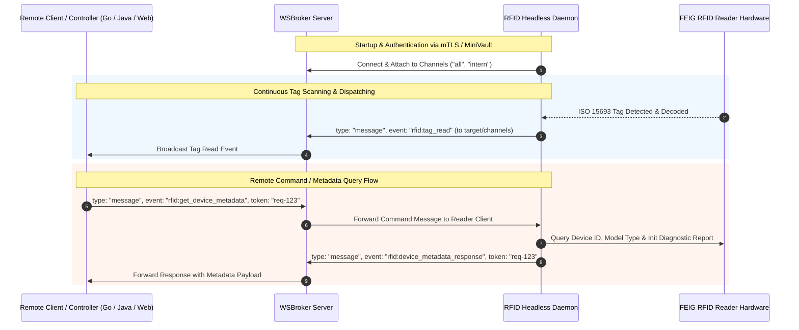

# RFID Headless - WebSocket & WSBroker Integration

`rfid-headless` provides native real-time WebSocket communication via **WSBroker**. It supports bi-directional interaction: continuously broadcasting RFID tag scan events to connected clients and channels, as well as receiving remote commands (such as querying reader hardware metadata, serial numbers, and diagnostic reports).

---

## Table of Contents

1. [Architecture & Overview](#1-architecture--overview)
2. [Configuration (`inventory.xml`)](#2-configuration-inventoryxml)
3. [Message Envelope Format](#3-message-envelope-format)
4. [Outbound Events: Tag Read (`rfid:tag_read`)](#4-outbound-events-tag-read-rfidtag_read)
5. [Inbound Commands & Queries](#5-inbound-commands--queries)
   - [Query Device Metadata (`rfid:get_device_metadata`)](#51-query-device-metadata-rfidget_device_metadata)
   - [Write Tag Data (`rfid:write_tag`)](#52-write-tag-data-rfidwrite_tag)
   - [Write AFI Byte (`rfid:rfid_write_afi` / `rfid:write_afi`)](#53-write-afi-byte-rfidrfid_write_afi--rfidwrite_afi)
   - [Supported Query & Command Formats / Aliases](#54-supported-query--command-formats--aliases)
6. [Outbound Responses](#6-outbound-responses)
   - [Device Metadata Response (`rfid:device_metadata_response`)](#61-device-metadata-response-rfiddevice_metadata_response)
   - [Write Tag Response (`rfid:write_tag_response`)](#62-write-tag-response-rfidwrite_tag_response)
   - [Write AFI Response (`rfid:write_afi_response`)](#63-write-afi-response-rfidwrite_afi_response)
7. [Integration Code Examples](#7-integration-code-examples)
   - [Java (`WSBrokerClient`)](#71-java-wsbrokerclient)
   - [Go (`wsbrokerdisplay` Controller)](#72-go-wsbrokerdisplay-controller)
   - [JavaScript / TypeScript / Web Browser](#73-javascript--typescript--web-browser)
8. [Security & Authentication (mTLS / MiniVault)](#8-security--authentication-mtls--minivault)

---

## 1. Architecture & Overview

When `rfid-headless` runs with WebSocket active (`<wsbroker><active>true</active>...`), it establishes an encrypted WebSocket connection to the configured WSBroker instance and subscribes to configured channels (e.g. `all`, `intern`).



---

## 2. Configuration (`inventory.xml`)

WebSocket settings are defined inside the `<wsbroker>` element of `inventory.xml`:

```xml
<configuration>
    <!-- WSBroker WebSocket Connection Configuration -->
    <wsbroker>
        <!-- Enable/disable WebSocket dispatching (true/false) -->
        <active>true</active>

        <!-- Unique client name used for WSBroker authentication and routing -->
        <name>rfid-reader-station-01</name>

        <!-- Target WSBroker endpoint URL (ws://, wss://, http://, https://) -->
        <url><![CDATA[https://localhost:8765]]></url>

        <!-- Initial channels to join upon startup -->
        <channels>
            <channel>all</channel>
            <channel>intern</channel>
        </channels>

        <!-- Client TLS / mTLS configuration via certmanager (minivault, file, env, dev) -->
        <clienttls>
            <type>minivault</type>

            <minivault>
                <baseurl><![CDATA[https://localhost:8759/api/v1]]></baseurl>
                <parenttoken><![CDATA[pa.22f09dfd1cbfbe9f.c17b29cb2b730533]]></parenttoken>
                <tokentype>client_cert</tokentype>
                <tokenpolicies>
                    <policy>wsbroker.client</policy>
                </tokenpolicies>
                <certtype>client_cert</certtype>
                <uris>
                    <uri>wsbroker:client:rfid-reader-station-01</uri>
                    <uri>wsbroker:channel:all</uri>
                    <uri>wsbroker:channel:intern</uri>
                </uris>
                <ca>
                    <path>certs/minivault.ca.pem</path>
                </ca>
                <usesystempool>false</usesystempool>
            </minivault>
        </clienttls>
    </wsbroker>

    <!-- Reader debounce time in milliseconds to prevent redundant event bursts -->
    <debounce>3000</debounce>
</configuration>
```

### Configuration Parameters:
| Element | Type | Description | Default / Example |
| :--- | :--- | :--- | :--- |
| `active` | boolean | Enables or disables WSBroker WebSocket communication. | `true` |
| `name` | string | Unique client name / identifier for this reader instance. | `rfid-station-01` |
| `url` | string | Target WSBroker server endpoint URL. | `https://localhost:8765` |
| `channels` | list | List of channels (`<channel>`) to automatically join. | `all`, `intern` |
| `clienttls` | object | mTLS and dynamic certificate provisioning via `certmanager`. | `minivault` or `file` |

---

## 3. Message Envelope Format

All communication via WSBroker conforms to the standard JSON event envelope:

```json
{
  "time": "2026-10-23T12:00:00Z",
  "source": "rfid-reader-station-01",
  "target": "all",
  "type": "message",
  "token": "optional-correlation-token-12345",
  "data": { ... }
}
```

### Envelope Fields:
* **`time`** *(string, ISO-8601)*: Timestamp when the message was generated.
* **`source`** *(string)*: Unique client identifier of the sender.
* **`target`** *(string)*: Target client identifier or channel name (`"all"`, `"intern"`, or specific client name).
* **`type`** *(string)*: Event type. Standard data exchanges and commands utilize `"message"`.
* **`token`** *(string, optional)*: Correlation ID used to correlate request commands with response messages.
* **`data`** *(object)*: Concrete payload (such as `TagReadPayload` or `DeviceMetadataPayload`).

---

## 4. Outbound Events: Tag Read (`rfid:tag_read`)

When an RFID tag (ISO 15693 / ISO 28560-2) is detected and decoded, `rfid-headless` sends a `rfid:tag_read` event to all configured channels.

### Tag Read JSON Example:
```json
{
  "time": "2026-10-23T12:00:01.123Z",
  "source": "rfid-reader-station-01",
  "target": "all",
  "type": "message",
  "data": {
    "event": "rfid:tag_read",
    "uid": "E004010000001234",
    "itemId": "3012345678",
    "isil": "000001-1",
    "country": "CH",
    "crcOk": true,
    "isCrcValid": true,
    "crc": "OK",
    "tagName": "ISO 15693 : NXP I-Code SLIX",
    "raw": "0102030405060708090A0B0C...",
    "parts": 1,
    "partNo": 1,
    "usageType": 1,
    "version": 1,
    "session": "main-scan",
    "timestamp": 1792756801123,
    "clientId": "rfid-reader-station-01"
  }
}
```

### Payload Fields:
| Field | Type | Description |
| :--- | :--- | :--- |
| `event` | string | Constant identifier: `"rfid:tag_read"`. |
| `uid` | string | Tag Unique Identifier (UID / Serial Hex, e.g. `E004010000001234`). |
| `itemId` | string | Decoded primary item identifier / barcode from the ISO 28560-2 data model. |
| `isil` | string | Library ISIL identifier (e.g. `000001-1`). |
| `country` | string | Country code from the data model (e.g. `CH`, `DE`). |
| `crcOk` / `isCrcValid` | boolean | `true` if ISO 28560 CRC-16 checksum validation passed. |
| `crc` | string | Human-readable CRC validation status (`"OK"` or `"ERROR"`). |
| `tagName` | string | Transponder / chip type identified by the reader driver. |
| `raw` | string | Raw hex dump of the decoded memory blocks. |
| `parts` | integer | Total parts in item (multi-part sets). |
| `partNo` | integer | Current part number (1-based index). |
| `usageType` | integer | Type of usage as defined in ISO 28560-2 (e.g. 1 = circulating). |
| `version` | integer | Data model format version (typically 1). |
| `timestamp` | long | Epoch millisecond timestamp of the scan event. |
| `clientId` | string | Identifier of the reader client that captured the tag. |

---

## 5. Inbound Commands & Queries

Remote clients (such as dashboards, web apps, or Go controllers) can query reader status and hardware metadata, as well as execute NFC/RFID transponder write operations by sending a `message` event.

### 5.1 Query Device Metadata (`rfid:get_device_metadata`)

To query device details (Device ID, Device Type, and initial initialization startup diagnostics report), send a `message` event to the reader client:

#### Query Request JSON:
```json
{
  "time": "2026-10-23T12:00:02.000Z",
  "source": "dashboard-ui",
  "target": "rfid-reader-station-01",
  "type": "message",
  "token": "req-98765-meta",
  "data": {
    "event": "rfid:get_device_metadata"
  }
}
```

### 5.2 Write Tag Data (`rfid:write_tag`)

To write ISO 28560-2 library metadata (and optionally the AFI byte) to an RFID tag, send a `message` event with event name `rfid:write_tag`.

> **Note on Concurrency & Timing:**
> During write operations, the autonomous scan loop is safely paused (`executeExclusive`). Settling delays before and after writing guarantee physical EEPROM write stability. Once completed, the reader's debounce cache is automatically cleared so that subsequent scans detect the updated tag immediately.

#### Write Tag Request JSON:
```json
{
  "time": "2026-10-23T12:00:03.000Z",
  "source": "dashboard-ui",
  "target": "rfid-reader-station-01",
  "type": "message",
  "token": "req-write-001",
  "data": {
    "event": "rfid:write_tag",
    "uid": "E004015099887766",
    "itemId": "3012345678",
    "isil": "CH-000001-1",
    "country": "CH",
    "parts": 1,
    "partno": 1,
    "usageType": 1,
    "afi": "07"
  }
}
```

#### Write Tag Parameters:
| Parameter | Type | Required | Description |
| :--- | :--- | :--- | :--- |
| `event` | string | **Yes** | Constant identifier: `"rfid:write_tag"`. |
| `uid` | string | Optional | Target tag UID (hex string, e.g. `E004015099887766`). If omitted or empty, writes to the transponder currently in the RF field. |
| `itemId` / `imtemId` | string | **Yes** | Primary item barcode / identifier to encode into ISO 28560 block format. |
| `isil` | string | Optional | Library ISIL identifier (e.g. `CH-000001-1`). |
| `country` | string | Optional | ISO country code (e.g. `CH`, `DE`). |
| `parts` | integer | Optional | Total count of parts in item set (default: `1`). |
| `partno` / `partNo` | integer | Optional | Current part number in item set (1-based index, default: `1`). |
| `usageType` | integer | Optional | ISO 28560 usage type (e.g. `1` = circulating items, default: `1`). |
| `afi` | string/int | Optional | AFI byte to program (e.g. `"07"`, `"0x07"`, `7`, `"C2"`). If omitted, AFI is left unchanged. |

---

### 5.3 Write AFI Byte (`rfid:rfid_write_afi` / `rfid:write_afi`)

To write or toggle the Application Family Identifier (AFI byte) independently (e.g. for security gate EAS check-in / check-out), send a `message` event with event `rfid:rfid_write_afi` or `rfid:write_afi`.

#### Write AFI Request JSON:
```json
{
  "time": "2026-10-23T12:00:04.000Z",
  "source": "dashboard-ui",
  "target": "rfid-reader-station-01",
  "type": "message",
  "token": "req-afi-002",
  "data": {
    "event": "rfid:rfid_write_afi",
    "uid": "E004015099887766",
    "afi": "07"
  }
}
```

#### Write AFI Parameters:
| Parameter | Type | Required | Description |
| :--- | :--- | :--- | :--- |
| `event` | string | **Yes** | Constant identifier: `"rfid:rfid_write_afi"` or `"rfid:write_afi"`. |
| `uid` | string | Optional | Target tag UID (hex string). If omitted, writes to the tag present in reader field. |
| `afi` | string/int | **Yes** | AFI byte value (e.g. `"07"`, `"0x07"`, `7`, `"C2"` for checked out / secured states). |

---

### 5.4 Supported Query & Command Formats / Aliases

The dispatcher accepts multiple command variations for high interoperability across diverse clients:

* **Metadata Query Events**:
  * `"rfid:get_device_metadata"` / `"get_device_metadata"`
  * `"rfid:get_device_info"` / `"get_device_info"`
  * `"rfid:device_metadata"` / `"device_metadata"`
  * `"rfid:get_status"` / `"get_status"`
  * `"rfid:get_metadata"` / `"get_metadata"`
  * `"query_device"` / `"device_info"` / `"info"`
* **Write Tag Events**:
  * `"rfid:write_tag"` / `"write_tag"`
  * `"rfid:writetag"` / `"writetag"`
* **Write AFI Events**:
  * `"rfid:rfid_write_afi"` / `"rfid_write_afi"`
  * `"rfid:write_afi"` / `"write_afi"`
  * `"rfid:set_afi"` / `"set_afi"`
* **Correlation Token**: If a `token` is included in any request, the daemon returns the exact same `token` in its response message for deterministic request-reply matching.
* **Targeting**: Requests may be addressed directly to the reader's client name (`target: "rfid-reader-station-01"`) or to a shared channel (e.g., `target: "intern"`).

---

## 6. Outbound Responses

When commands or queries are received, `rfid-headless` processes them and responds with a `message` event.

### 6.1 Device Metadata Response (`rfid:device_metadata_response`)

```json
{
  "time": "2026-10-23T12:00:02.045Z",
  "source": "rfid-reader-station-01",
  "target": "dashboard-ui",
  "type": "message",
  "token": "req-98765-meta",
  "data": {
    "event": "rfid:device_metadata_response",
    "status": "ok",
    "deviceId": "0052E688",
    "deviceType": "ISC.MR102-USB",
    "initDescription": "FEIG Electronic ISC.MR102-USB (0052E688)\nFirmware: V03.01.00\nSDK: Gen3 Java v7.1.0\nInterface: USB (Native Lib: libfecom.so)\nReader initialized successfully. RF Field active.",
    "session": "",
    "timestamp": 1792756802045,
    "clientId": "rfid-reader-station-01"
  }
}
```

---

### 6.2 Write Tag Response (`rfid:write_tag_response`)

```json
{
  "time": "2026-10-23T12:00:03.350Z",
  "source": "rfid-reader-station-01",
  "target": "dashboard-ui",
  "type": "message",
  "token": "req-write-001",
  "data": {
    "event": "rfid:write_tag_response",
    "status": "ok",
    "uid": "E004015099887766",
    "itemId": "3012345678",
    "isil": "CH-000001-1",
    "country": "CH",
    "parts": 1,
    "partNo": 1,
    "usageType": 1,
    "afi": "07",
    "message": "Tag written successfully",
    "timestamp": 1792756803350,
    "clientId": "rfid-reader-station-01"
  }
}
```

*In case of an error (e.g. tag collision or transponder not found):*
```json
{
  "time": "2026-10-23T12:00:03.350Z",
  "source": "rfid-reader-station-01",
  "target": "dashboard-ui",
  "type": "message",
  "token": "req-write-001",
  "data": {
    "event": "rfid:write_tag_response",
    "status": "error",
    "uid": "E004015099887766",
    "itemId": "3012345678",
    "message": "Tag with UID 'E004015099887766' not found in reader field",
    "error": "Tag with UID 'E004015099887766' not found in reader field",
    "timestamp": 1792756803350,
    "clientId": "rfid-reader-station-01"
  }
}
```

---

### 6.3 Write AFI Response (`rfid:write_afi_response`)

```json
{
  "time": "2026-10-23T12:00:04.280Z",
  "source": "rfid-reader-station-01",
  "target": "dashboard-ui",
  "type": "message",
  "token": "req-afi-002",
  "data": {
    "event": "rfid:write_afi_response",
    "status": "ok",
    "uid": "E004015099887766",
    "afi": "07",
    "message": "AFI written successfully",
    "timestamp": 1792756804280,
    "clientId": "rfid-reader-station-01"
  }
}
```

---

## 7. Integration Code Examples

### 7.1 Java (`WSBrokerClient`)

Using the Java `wsbrokerclient` module:

```java
import org.objectspace.wsbrokerclient.client.WSBrokerClient;
import org.objectspace.wsbrokerclient.event.Event;

// 1. Initialize client
WSBrokerClient client = new WSBrokerClient("wss://localhost:8765", "dashboard-app", sslContext);
client.connect().join();

// 2. Listen for tag read and write response events
client.onMessage(event -> {
    if (event.getData() != null) {
        String evtType = event.getData().path("event").asText();
        if ("rfid:tag_read".equals(evtType)) {
            String itemId = event.getData().path("itemId").asText();
            String uid = event.getData().path("uid").asText();
            System.out.printf("Scanned Item: %s (UID: %s)%n", itemId, uid);
        } else if ("rfid:write_tag_response".equals(evtType)) {
            String status = event.getData().path("status").asText();
            String uid = event.getData().path("uid").asText();
            System.out.printf("Write Tag [%s]: UID=%s%n", status, uid);
        } else if ("rfid:write_afi_response".equals(evtType)) {
            String status = event.getData().path("status").asText();
            String afi = event.getData().path("afi").asText();
            System.out.printf("Write AFI [%s]: AFI=%s%n", status, afi);
        }
    }
});

// 3. Send write_tag command
Event writeTagCmd = Event.createMessage("dashboard-app", "rfid-reader-station-01", Map.of(
    "event", "rfid:write_tag",
    "uid", "E004015099887766",
    "itemId", "3012345678",
    "isil", "CH-000001-1",
    "country", "CH",
    "parts", 1,
    "partno", 1,
    "afi", "07"
));
writeTagCmd.setToken("req-write-001");
client.send(writeTagCmd);

// 4. Send rfid_write_afi command
Event writeAfiCmd = Event.createMessage("dashboard-app", "rfid-reader-station-01", Map.of(
    "event", "rfid:rfid_write_afi",
    "uid", "E004015099887766",
    "afi", "C2"
));
writeAfiCmd.setToken("req-afi-002");
client.send(writeAfiCmd);
```

---

### 7.2 Go (`wsbrokerdisplay` Controller)

Handling events in Go compatible with `wsbrokerdisplay` / `HandleEvent()` pattern:

```go
package main

import (
	"encoding/json"
	"fmt"
	"log"
)

type Event struct {
	Time   string          `json:"time,omitempty"`
	Source string          `json:"source,omitempty"`
	Target string          `json:"target,omitempty"`
	Type   string          `json:"type,omitempty"`
	Token  string          `json:"token,omitempty"`
	Data   json.RawMessage `json:"data,omitempty"`
}

type WriteTagResponse struct {
	Event   string `json:"event"`
	Status  string `json:"status"`
	UID     string `json:"uid"`
	ItemID  string `json:"itemId"`
	ISIL    string `json:"isil"`
	Country string `json:"country"`
	AFI     string `json:"afi"`
	Message string `json:"message"`
	Error   string `json:"error"`
}

type WriteAfiResponse struct {
	Event   string `json:"event"`
	Status  string `json:"status"`
	UID     string `json:"uid"`
	AFI     string `json:"afi"`
	Message string `json:"message"`
	Error   string `json:"error"`
}

func HandleEvent(evt *Event) error {
	if evt.Type != "message" || len(evt.Data) == 0 {
		return nil
	}

	var header struct {
		Event string `json:"event"`
	}
	if err := json.Unmarshal(evt.Data, &header); err != nil {
		return nil
	}

	switch header.Event {
	case "rfid:write_tag_response":
		var resp WriteTagResponse
		_ = json.Unmarshal(evt.Data, &resp)
		fmt.Printf("Tag Write Result: Status=%s | UID=%s | ItemID=%s | Token=%s\n",
			resp.Status, resp.UID, resp.ItemID, evt.Token)

	case "rfid:write_afi_response":
		var resp WriteAfiResponse
		_ = json.Unmarshal(evt.Data, &resp)
		fmt.Printf("AFI Write Result: Status=%s | UID=%s | AFI=%s | Token=%s\n",
			resp.Status, resp.UID, resp.AFI, evt.Token)
	}

	return nil
}
```

---

### 7.3 JavaScript / TypeScript / Web Browser

Connecting via standard browser WebSocket:

```javascript
const ws = new WebSocket("wss://localhost:8765");

ws.onopen = () => {
    console.log("Connected to WSBroker");

    // 1. Subscribe / Join channel
    ws.send(JSON.stringify({
        type: "attach",
        source: "web-ui",
        target: "all"
    }));

    // 2. Send Write Tag Command
    ws.send(JSON.stringify({
        type: "message",
        source: "web-ui",
        target: "rfid-reader-station-01",
        token: "web-req-write-001",
        data: {
            event: "rfid:write_tag",
            uid: "E004015099887766",
            itemId: "3012345678",
            isil: "CH-000001-1",
            country: "CH",
            parts: 1,
            partno: 1,
            afi: "07"
        }
    }));

    // 3. Send Write AFI Command
    ws.send(JSON.stringify({
        type: "message",
        source: "web-ui",
        target: "rfid-reader-station-01",
        token: "web-req-afi-002",
        data: {
            event: "rfid:rfid_write_afi",
            uid: "E004015099887766",
            afi: "07"
        }
    }));
};

ws.onmessage = (event) => {
    const msg = JSON.parse(event.data);

    if (msg.type === "message" && msg.data) {
        if (msg.data.event === "rfid:write_tag_response") {
            console.log(`Write Tag [${msg.data.status}]: UID=${msg.data.uid}, Token=${msg.token}`);
        } else if (msg.data.event === "rfid:write_afi_response") {
            console.log(`Write AFI [${msg.data.status}]: UID=${msg.data.uid}, AFI=${msg.data.afi}`);
        }
    }
};
```

---

## 8. Security & Authentication (mTLS / MiniVault)

`rfid-headless` integrates with the `certmanager` module to provide enterprise-grade security:

* **mTLS (Mutual TLS)**: Authenticates both client and broker over TLS 1.3 / 1.2 with mutual x509 certificate validation.
* **MiniVault Dynamic Token Provisioning**: Automatically fetches short-lived client certificates using a parent token, eliminating manual certificate rotations on remote edge nodes (e.g. Raspberry Pi devices).
* **Policy Isolation**: WSBroker enforces URI SAN policies (e.g., `wsbroker:client:<client_id>`, `wsbroker:channel:<channel>`), ensuring that readers can only publish to authorized channels and receive authorized commands.
