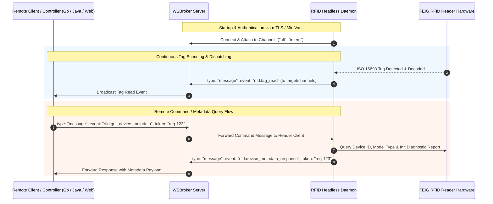

# RFID Headless - WebSocket & WSBroker Integration

`rfid-headless` provides native real-time WebSocket communication via **WSBroker**. It supports bi-directional interaction: continuously broadcasting RFID tag scan events to connected clients and channels, as well as receiving remote commands (such as querying reader hardware metadata, serial numbers, and diagnostic reports).

---

## Table of Contents

1. [Architecture & Overview](#1-architecture--overview)
2. [Configuration (`inventory.xml`)](#2-configuration-inventoryxml)
3. [Message Envelope Format](#3-message-envelope-format)
4. [Continuous Events & Broadcasts](#4-continuous-events--broadcasts)
   - [Tag Read (`rfid:tag_read`)](#41-tag-read-rfidtag_read)
   - [Reader / Plate Cleared (`rfid:tags_cleared`)](#42-reader--plate-cleared-rfidtags_cleared)
5. [Commands, Queries & Responses](#5-commands-queries--responses)
   - [Device Metadata Query & Response (`rfid:get_device_metadata`)](#51-device-metadata-query--response-rfidget_device_metadata)
   - [Write Tag Data & Response (`rfid:write_tag`)](#52-write-tag-data--response-rfidwrite_tag)
   - [Write AFI Byte & Response (`rfid:write_afi`)](#53-write-afi-byte--response-rfidwrite_afi)
   - [Supported Query & Command Formats / Aliases](#54-supported-query--command-formats--aliases)
6. [Integration Code Examples](#6-integration-code-examples)
   - [Java (`WSBrokerClient`)](#61-java-wsbrokerclient)
   - [Go (`wsbrokerdisplay` Controller)](#62-go-wsbrokerdisplay-controller)
   - [JavaScript / TypeScript / Web Browser](#63-javascript--typescript--web-browser)
7. [Security & Authentication (mTLS / MiniVault)](#7-security--authentication-mtls--minivault)

---

## 1. Architecture & Overview

When `rfid-headless` runs with WebSocket active (`<wsbroker><active>true</active>...`), it establishes an encrypted WebSocket connection to the configured WSBroker instance and subscribes to configured channels (e.g. `all`, `intern`).



---

## 2. Configuration (`inventory.xml`)

WebSocket settings are defined inside the `<wsbroker>` element of `inventory.xml`:

```xml
<configuration>
    <!-- WSBroker WebSocket Connection Configuration -->
    <wsbroker>
        <!-- Enable/disable WebSocket dispatching (true/false) -->
        <active>true</active>

        <!-- Unique client name used for WSBroker authentication and routing -->
        <name>rfid:reader:01</name>

        <!-- Target WSBroker endpoint URL (ws://, wss://, http://, https://) -->
        <url><![CDATA[https://localhost:8765]]></url>

        <!-- Initial channels to join upon startup -->
        <channels>
            <channel>all</channel>
            <channel>intern</channel>
        </channels>

        <!-- Client TLS / mTLS configuration via certmanager (minivault, file, env, dev) -->
        <clienttls>
            <type>minivault</type>

            <minivault>
                <baseurl><![CDATA[https://localhost:8759/api/v1]]></baseurl>
                <parenttoken><![CDATA[pa.22f09dfd1cbfbe9f.c17b29cb2b730533]]></parenttoken>
                <tokentype>client_cert</tokentype>
                <tokenpolicies>
                    <policy>wsbroker.client</policy>
                </tokenpolicies>
                <certtype>client_cert</certtype>
                <uris>
                    <uri>wsbroker:client:rfid:reader:01</uri>
                    <uri>wsbroker:channel:all</uri>
                    <uri>wsbroker:channel:intern</uri>
                </uris>
                <ca>
                    <path>certs/minivault.ca.pem</path>
                </ca>
                <usesystempool>false</usesystempool>
            </minivault>
        </clienttls>
    </wsbroker>

    <!-- Reader debounce time in milliseconds to prevent redundant event bursts -->
    <debounce>3000</debounce>
</configuration>
```

### Configuration Parameters:
| Element | Type | Description | Default / Example |
| :--- | :--- | :--- | :--- |
| `active` | boolean | Enables or disables WSBroker WebSocket communication. | `true` |
| `name` | string | Unique client name / identifier for this reader instance. | `rfid-station-01` |
| `url` | string | Target WSBroker server endpoint URL. | `https://localhost:8765` |
| `channels` | list | List of channels (`<channel>`) to automatically join. | `all`, `intern` |
| `clienttls` | object | mTLS and dynamic certificate provisioning via `certmanager`. | `minivault` or `file` |

### Multi-Reader Configuration (`<readers>`):

`rfid-headless` supports connecting multiple RFID readers simultaneously on one host. Each reader is configured inside `<readers><reader>...</reader></readers>`:

```xml
<configuration>
    <!-- Multi-Reader Configuration -->
    <readers>
        <reader>
            <reader_id>gate-01</reader_id>
            <readonly>false</readonly>
            <feig>
                <id>52E688</id>
                <type>usb</type>
            </feig>
            <debounce>2500</debounce>
            <sleep>200</sleep>
            <numblocks>12</numblocks>
            <!-- Optional reader-specific WSBroker channels -->
            <channels>
                <channel>rfid:gates</channel>
                <channel>rfid:gate-01</channel>
            </channels>
        </reader>
        <reader>
            <reader_id>return-station</reader_id>
            <readonly>true</readonly>
            <feig>
                <id>52E689</id>
                <type>usb</type>
            </feig>
            <debounce>2000</debounce>
            <sleep>250</sleep>
            <channels>
                <channel>rfid:returns</channel>
            </channels>
        </reader>
    </readers>

    <!-- WSBroker settings shared by all readers -->
    <wsbroker>
        <active>true</active>
        <name>rfid-hub-01</name>
        <url><![CDATA[https://localhost:8765]]></url>
        <!-- Global fallback channels; deduplicated with reader-specific channels on connect -->
        <channels>
            <channel>all</channel>
            <channel>intern</channel>
        </channels>
    </wsbroker>
</configuration>
```

#### Reader Configuration Elements:
| Element | Type | Description | Default |
| :--- | :--- | :--- | :--- |
| `reader_id` / `id` | string | Unique logical name for this reader instance (e.g. `gate-01`, `return-station`). | Generated |
| `readonly` | boolean | When `true`, write commands (`rfid:write_tag`, `rfid:write_afi`) are rejected with an error. | `false` |
| `feig/id` | string | Hardware USB serial / Device ID for FEIG reader. | First available |
| `feig/type` | string | Hardware interface type (e.g. `usb`). | `usb` |
| `channels` | list | Optional list of channels (`<channel>`) to target for events originating from this reader. If omitted, global WSBroker channels are used. Deduplicated across all readers on startup. | Global channels |
| `debounce` | long | Per-reader debounce cooldown in milliseconds. | Global debounce |
| `sleep` | integer | Per-reader inventory scan cycle sleep in milliseconds. | Global sleep (300) |
| `numblocks` | integer | Per-reader block count to read from transponders. | Global numblocks (12) |

---

## 3. Message Envelope Format

All communication via WSBroker conforms to the standard JSON event envelope (`Event<RfidPayload<T>>`):

```json
{
  "id": "optional-message-id",
  "refId": "optional-referenced-message-id",
  "channel": "intern",
  "time": "2026-10-23T12:00:00Z",
  "source": "rfid:reader:01",
  "target": "all",
  "type": "message",
  "session": "main-scan",
  "message": "[TAG READ] Reader: gate-01 | UID: E004010000001234 ...",
  "data": {
    "event": "rfid:tag_read",
    "data": { ... }
  }
}
```

### Envelope Fields:
* **`id`** *(string, optional)*: Unique message identifier assigned by WSBroker or sender.
* **`refId`** *(string, optional)*: Reference message ID correlating a response directly to the `id` of the originating request message.
* **`channel`** *(string, optional)*: Channel name through which the message was routed/broadcast.
* **`time`** *(string, ISO-8601)*: Timestamp when the message was generated.
* **`source`** *(string)*: Unique client identifier of the sender.
* **`target`** *(string)*: Target client identifier or channel name (`"all"`, `"intern"`, or specific client name).
* **`type`** *(string)*: Event type (standard data exchanges and commands utilize `"message"`).
* **`session`** *(string, optional)*: Active reader inventory session identifier.
* **`message`** *(string, optional)*: Human-readable summary log line for quick inspection.
* **`error`** *(string, optional)*: High-level error message if the event represents an error condition.
* **`data`** *(object)*: `RfidPayload<T>` envelope containing:
  * **`event`** *(string)*: RFID event identifier (e.g. `"rfid:tag_read"`, `"rfid:tags_cleared"`, `"rfid:device_metadata_response"`, `"rfid:write_tag_response"`, `"rfid:write_afi_response"`).
  * **`data`** *(object)*: Strongly-typed data record (e.g. `TagReadData`, `TagsClearedData`, `DeviceMetadataData`, `WriteTagResponseData`, `WriteAfiResponseData`). Logical reader identification (`readerId`) is cleanly encapsulated inside this data object.

---

## 4. Continuous Events & Broadcasts

`rfid-headless` continuously publishes real-time outbound events to configured WSBroker channels (e.g., `all`, `intern`) to notify downstream consumers of physical transponder scans and reader status changes.

### 4.1 Tag Read (`rfid:tag_read`)

When an RFID tag (ISO 15693 / ISO 28560-2) is detected and decoded, `rfid-headless` sends a `rfid:tag_read` event with a `TagReadData` payload to all configured channels.

#### Tag Read JSON Example:
```json
{
  "time": "2026-10-23T12:00:01.123Z",
  "source": "rfid:reader:01",
  "target": "all",
  "type": "message",
  "message": "[TAG READ] Reader: gate-01 | UID: E004010000001234 | ItemID: 3012345678 | ISIL: 000001-1 | Country: CH | CRC: OK | AFI: 07 | TagType: ISO 15693 : NXP I-Code SLIX",
  "data": {
    "event": "rfid:tag_read",
    "data": {
      "uid": "E004010000001234",
      "itemId": "3012345678",
      "rawHex": "0102030405060708090A0B0C...",
      "isil": "000001-1",
      "country": "CH",
      "crcOk": true,
      "tagName": "ISO 15693 : NXP I-Code SLIX",
      "metadata": {
        "primaryItemId": "3012345678",
        "countryOfOwnerLib": "CH",
        "ownerLibISIL": "000001-1",
        "partNumber": 1,
        "partsInItem": 1,
        "typeOfUsage": 1,
        "version": 1
      },
      "afi": "07",
      "readerId": "gate-01"
    }
  }
}
```

#### `TagReadData` Payload Fields:
| Field | Type | Aliases | Description |
| :--- | :--- | :--- | :--- |
| `uid` | string | `uid` | Tag Unique Identifier (UID / Serial Hex, e.g. `E004010000001234`). |
| `itemId` | string | `item_id`, `itemID` | Decoded primary item identifier / barcode from the ISO 28560-2 data model. |
| `rawHex` | string | `raw`, `raw_hex`, `raw_data` | Raw hex dump of the decoded memory blocks. |
| `isil` | string | `isil` | Library ISIL identifier (e.g. `000001-1`). |
| `country` | string | `country` | ISO country code from the data model (e.g. `CH`, `DE`). |
| `crcOk` | boolean | `crc_ok`, `isCrcValid`, `crc` | `true` if ISO 28560 CRC-16 checksum validation passed. |
| `tagName` | string | `tag_name`, `type` | Transponder / chip type identified by the reader driver (e.g. `SLIX`, `SLIX2`). |
| `metadata` | object | `metadata` | Full decoded ISO 28560 `FinnishDataModel` structure. |
| `afi` | string | `afi` | Application Family Identifier (2-digit hex string, e.g. `"07"` for items in stock / secured, `"C2"` for loaned items). |
| `readerId` | string | `reader_id`, `readerID` | Logical reader identifier (e.g. `"gate-01"`, `"return-station"`) configured in `inventory.xml`. |

---

### 4.2 Reader / Plate Cleared (`rfid:tags_cleared`)

When transponders are no longer detected on the reader antenna, or when the reader hardware disconnects, `rfid-headless` immediately broadcasts a `rfid:tags_cleared` event with a `TagsClearedData` payload. This guarantees that client UIs, automated sorter PLCs, and ILS systems clear displayed items instantly and do not retain stale state.

#### Trigger Conditions:
1. **Physical Tag Removal**: When all tags are removed from the RF field (detected by the inventory cycle encountering an empty plate).
2. **Hardware Disconnection**: When the RFID reader is unplugged, loses power, or suffers communication failure during scanning cycles.
3. **Daemon Shutdown**: When `rfid-headless` or `HeadlessReaderScanner` is cleanly stopped or terminated via SIGINT/SIGTERM.
4. **Post-Write Operation Notification**: After exclusive transponder write operations (`rfid:write_tag`, `rfid:write_afi`), before the reader resumes scanning, a `rfid:tags_cleared` event is dispatched so downstream clients clear previous tag state before receiving fresh scans of updated transponders.

#### Cleared Event JSON Example:
```json
{
  "time": "2026-10-23T12:00:05.100Z",
  "source": "rfid:reader:01",
  "target": "all",
  "type": "message",
  "message": "[READER CLEARED] Reader: gate-01 | All RFID tags removed from reader field",
  "data": {
    "event": "rfid:tags_cleared",
    "data": {
      "status": "empty",
      "totalTags": 0,
      "readerId": "gate-01"
    }
  }
}
```

#### `TagsClearedData` Payload Fields:
| Field | Type | Aliases | Description |
| :--- | :--- | :--- | :--- |
| `status` | string | `status` | Clearance status indicator (`"empty"`). |
| `totalTags` | integer | `total_tags`, `count` | Total count of active tags remaining on the plate (`0`). |
| `readerId` | string | `reader_id`, `readerID` | Logical reader identifier (e.g. `"gate-01"`, `"return-station"`). |

---

## 5. Commands, Queries & Responses

Remote clients (such as dashboards, web apps, or Go controllers) can query reader status and hardware metadata, as well as execute NFC/RFID transponder write operations by sending `message` events. The daemon processes these requests and returns corresponding response messages correlated via `token` and `refId`.

### 5.1 Device Metadata Query & Response (`rfid:get_device_metadata`)

To query device details (Device ID, Device Type, and initial initialization startup diagnostics report), send a `message` event to the reader client. In a multi-reader environment, specify `readerId` to query a specific reader.

#### Query Request JSON:
```json
{
  "id": "req-98765-meta",
  "time": "2026-10-23T12:00:02.000Z",
  "source": "dashboard-ui",
  "target": "rfid:reader:01",
  "type": "message",
  "token": "req-98765-meta",
  "data": {
    "event": "rfid:get_device_metadata",
    "readerId": "gate-01"
  }
}
```

#### Query Parameters:
| Parameter | Type | Required | Description |
| :--- | :--- | :--- | :--- |
| `event` | string | **Yes** | Event identifier: `"rfid:get_device_metadata"` (or aliases). |
| `readerId` / `reader_id` | string | Optional | Logical identifier of the target reader in multi-reader setups. |

#### Device Metadata Response JSON (`rfid:device_metadata_response`):
```json
{
  "id": "resp-meta-001",
  "refId": "req-98765-meta",
  "time": "2026-10-23T12:00:02.045Z",
  "source": "rfid:reader:01",
  "target": "dashboard-ui",
  "type": "message",
  "message": "[DEVICE METADATA] Status: ok | ID: 0052E688 | Type: ISC.MR102-USB | Description: FEIG Electronic ISC.MR102-USB (0052E688)...",
  "data": {
    "event": "rfid:device_metadata_response",
    "data": {
      "status": "ok",
      "deviceId": "0052E688",
      "deviceType": "ISC.MR102-USB",
      "initDescription": "FEIG Electronic ISC.MR102-USB (0052E688)\nFirmware: V03.01.00\nSDK: Gen3 Java v7.1.0\nInterface: USB (Native Lib: libfecom.so)\nReader initialized successfully. RF Field active.",
      "readerId": "gate-01"
    }
  }
}
```

#### `DeviceMetadataData` Payload Fields:
| Field | Type | Aliases | Description |
| :--- | :--- | :--- | :--- |
| `status` | string | `status` | Query status (`"ok"` or `"error"`). |
| `deviceId` | string | `deviceID`, `Device ID`, `device_id` | Unique hardware identifier / USB serial of the FEIG RFID reader. |
| `deviceType` | string | `Device Type`, `device_type` | Hardware reader model (e.g. `"ISC.MR102-USB"`). |
| `initDescription` | string | `description`, `completeDescription`, `init_description` | Detailed hardware startup diagnostics report from initialization. |
| `readerId` | string | `reader_id`, `readerID` | Logical reader identifier (e.g. `"gate-01"`, `"return-station"`). |

---

### 5.2 Write Tag Data & Response (`rfid:write_tag`)

To write ISO 28560-2 library metadata (and optionally the AFI byte) to an RFID tag or multiple RFID tags, send a `message` event with event name `rfid:write_tag`.

Both single-tag writing and multi-tag batch writing with individual data per transponder UID are supported:
- **Single Tag**: Direct payload with single UID and item data (or wildcard for single transponder on plate).
- **Multi-Tag Array**: Payload with `tags` / `items` list containing per-transponder specifications (`uid`, `itemId`, `partNo`, `parts`, `afi`, etc.).
- **Multi-Tag Map**: Payload with `tags` / `items` map or root-level map (`UID -> { itemId, partNo, afi, ... }` or `UID -> "itemId"`).
- **Parallel Arrays**: Payload with `uids`, `itemIds`, and optional `afis`.

> **Note on Concurrency, Reader Targeting & Read-Only Protection:**
> - In multi-reader mode, specify `readerId` (or `target`) to direct the write command to a specific reader.
> - During write operations, only the target reader's autonomous scan loop is safely paused (`executeExclusive`), while other readers continue scanning without interruption.
> - If the target reader is configured with `readonly="true"`, write operations are immediately rejected with an error response (`status: "error"`, `error: "Reader '<reader_id>' is configured as read-only"`).

#### Single Tag Write Request JSON:
```json
{
  "id": "req-write-001",
  "time": "2026-10-23T12:00:03.000Z",
  "source": "dashboard-ui",
  "target": "rfid:reader:01",
  "type": "message",
  "token": "req-write-001",
  "data": {
    "event": "rfid:write_tag",
    "readerId": "gate-01",
    "uid": "E004015099887766",
    "itemId": "3012345678",
    "isil": "000001-1",
    "country": "CH",
    "parts": 1,
    "partno": 1,
    "usageType": 1,
    "afi": "07"
  }
}
```

#### Multi-Tag Batch Write Request JSON (List of Tags with Individual Data & AFI):
```json
{
  "id": "req-write-batch-001",
  "time": "2026-10-23T12:00:03.100Z",
  "source": "dashboard-ui",
  "target": "rfid:reader:01",
  "type": "message",
  "token": "req-write-batch-001",
  "data": {
    "event": "rfid:write_tag",
    "readerId": "gate-01",
    "tags": [
      {
        "uid": "E004015099887766",
        "itemId": "3012345678",
        "isil": "000001-1",
        "country": "CH",
        "parts": 2,
        "partNo": 1,
        "afi": "07"
      },
      {
        "uid": "E004015099887777",
        "itemId": "3012345679",
        "isil": "000001-1",
        "country": "CH",
        "parts": 2,
        "partNo": 2,
        "afi": "C2"
      }
    ]
  }
}
```

#### Write Tag Parameters:
| Parameter | Type | Required | Description |
| :--- | :--- | :--- | :--- |
| `event` | string | **Yes** | Constant identifier: `"rfid:write_tag"`. |
| `readerId` / `reader_id` | string | Optional | Logical identifier of the target reader (routes command to specific reader in multi-reader setups). |
| `uid` / `UID` | string | Optional | Target tag UID (hex string, e.g. `E004015099887766`). If omitted or empty in single-write mode, writes to the transponder currently in the RF field. |
| `tags` / `items` | array or map | Optional | List or Map of transponder write specifications (`uid`, `itemId`, `partNo`, `afi`, etc.) for batch writing where each UID has its own data. |
| `itemId` / `barcode` | string | Optional | Primary item barcode / identifier to encode into ISO 28560 block format (per item or default). |
| `isil` | string | Optional | Library ISIL identifier (e.g. `000001-1`). |
| `country` | string | Optional | ISO country code (e.g. `CH`, `DE`). |
| `parts` | integer | Optional | Total count of parts in item set (default: `1`). |
| `partno` / `partNo` | integer | Optional | Current part number in item set (1-based index, default: `1`). |
| `usageType` | integer | Optional | ISO 28560 usage type (e.g. `1` = circulating items, default: `1`). |
| `afi` | string/int | Optional | AFI byte to program (e.g. `"07"`, `"0x07"`, `7`, `"C2"`). If omitted, AFI is left unchanged. |

#### Write Tag Success Response JSON (`rfid:write_tag_response`):
```json
{
  "id": "resp-write-001",
  "refId": "req-write-001",
  "time": "2026-10-23T12:00:03.350Z",
  "source": "rfid:reader:01",
  "target": "dashboard-ui",
  "type": "message",
  "message": "[WRITE TAG] Status: ok | UID: E004015099887766 | ItemID: 3012345678 | AFI: 07",
  "data": {
    "event": "rfid:write_tag_response",
    "data": {
      "status": "ok",
      "uid": "E004015099887766",
      "itemId": "3012345678",
      "isil": "000001-1",
      "country": "CH",
      "parts": 1,
      "partNo": 1,
      "afi": "07",
      "successfulUids": ["E004015099887766"],
      "failedUids": [],
      "errors": {},
      "error": null,
      "readerId": "gate-01"
    }
  }
}
```

*In case of an error (e.g. read-only reader, tag collision, or transponder not found):*
```json
{
  "id": "resp-write-001",
  "refId": "req-write-001",
  "time": "2026-10-23T12:00:03.350Z",
  "source": "rfid:reader:01",
  "target": "dashboard-ui",
  "type": "message",
  "message": "[WRITE TAG] Status: error | UID: E004015099887766 | Error: Reader 'return-station' is configured as read-only",
  "data": {
    "event": "rfid:write_tag_response",
    "data": {
      "status": "error",
      "uid": "E004015099887766",
      "itemId": "3012345678",
      "error": "Reader 'return-station' is configured as read-only",
      "successfulUids": [],
      "failedUids": ["E004015099887766"],
      "errors": {
        "E004015099887766": "Reader 'return-station' is configured as read-only"
      },
      "readerId": "return-station"
    }
  }
}
```

#### `WriteTagResponseData` Payload Fields:
| Field | Type | Aliases | Description |
| :--- | :--- | :--- | :--- |
| `status` | string | `status` | Operation status (`"ok"`, `"partial"`, or `"error"`). |
| `uid` | string | `uid` | Primary transponder UID written. |
| `itemId` | string | `item_id`, `itemID` | Item barcode / identifier written to the tag. |
| `isil` | string | `isil` | Library ISIL identifier written to the tag. |
| `country` | string | `country` | ISO country code written to the tag. |
| `parts` | integer | `parts` | Total count of parts in item set. |
| `partNo` | integer | `partno`, `part_no` | Part number written to the tag. |
| `afi` | string | `afi` | AFI byte written to the tag (2-digit hex). |
| `successfulUids` | list of strings | `successful_uids`, `successUids` | List of transponder UIDs that were successfully programmed. |
| `failedUids` | list of strings | `failed_uids`, `failureUids` | List of transponder UIDs that failed to be programmed. |
| `errors` | map | `errors` | Map of UID to error description for failed transponders. |
| `error` | string | `error` | Error message description (or `null` on full success). |
| `readerId` | string | `reader_id`, `readerID` | Logical reader identifier where the command was executed. |

---

### 5.3 Write AFI Byte & Response (`rfid:write_afi`)

To write or toggle the Application Family Identifier (AFI byte) independently (e.g. for security gate EAS check-in / check-out), send a `message` event with event `rfid:write_afi`.

Both single-UID writes and batch multi-UID writes are supported. When a list of UIDs is supplied, the background scan loop of the target reader is paused once (`executeExclusive`), programming all specified transponders in a single exclusive reader session with precise settling times and error tracking per UID.

#### Single Tag Write AFI Request JSON:
```json
{
  "id": "req-afi-002",
  "time": "2026-10-23T12:00:04.000Z",
  "source": "dashboard-ui",
  "target": "rfid:reader:01",
  "type": "message",
  "data": {
    "event": "rfid:write_afi",
    "readerId": "gate-01",
    "uid": "E004015099887766",
    "afi": "07"
  }
}
```

#### Batch Multi-Tag Write AFI Request JSON:
```json
{
  "id": "req-afi-batch-003",
  "time": "2026-10-23T12:00:04.100Z",
  "source": "dashboard-ui",
  "target": "rfid:reader:01",
  "type": "message",
  "data": {
    "event": "rfid:write_afi",
    "readerId": "gate-01",
    "uids": ["E004015099887766", "E004015099887777"],
    "afi": "C2"
  }
}
```

#### Write AFI Parameters:
| Parameter | Type | Required | Description |
| :--- | :--- | :--- | :--- |
| `event` | string | **Yes** | Constant identifier: `"rfid:write_afi"`. |
| `readerId` / `reader_id` | string | Optional | Logical identifier of the target reader. |
| `uid` / `UID` | string | Optional | Single target tag UID (hex string). If omitted and `uids` is omitted, writes to the tag present in reader field. |
| `uids` / `UIDs` | array of strings | Optional | Array of target tag UIDs for batch programming within a single scanner pause cycle. |
| `afi` / `AFI` | string/int | **Yes** | AFI byte value (e.g. `"07"`, `"0x07"`, `7`, `"C2"` for checked out / secured states). |

#### Single Tag Success Response JSON (`rfid:write_afi_response`):
```json
{
  "id": "resp-afi-001",
  "refId": "req-afi-002",
  "time": "2026-10-23T12:00:04.280Z",
  "source": "rfid:reader:01",
  "target": "dashboard-ui",
  "type": "message",
  "message": "[WRITE AFI] Status: ok | UID: E004015099887766 | AFI: 07",
  "data": {
    "event": "rfid:write_afi_response",
    "data": {
      "status": "ok",
      "uid": "E004015099887766",
      "afi": "07",
      "successfulUids": ["E004015099887766"],
      "failedUids": [],
      "errors": {},
      "error": null,
      "readerId": "gate-01"
    }
  }
}
```

#### Batch Write Success Response JSON:
```json
{
  "id": "resp-afi-002",
  "refId": "req-afi-batch-003",
  "time": "2026-10-23T12:00:04.350Z",
  "source": "rfid:reader:01",
  "target": "dashboard-ui",
  "type": "message",
  "message": "[WRITE AFI] Status: ok | 2 tags written | AFI: C2",
  "data": {
    "event": "rfid:write_afi_response",
    "data": {
      "status": "ok",
      "uid": "E004015099887766",
      "afi": "C2",
      "successfulUids": ["E004015099887766", "E004015099887777"],
      "failedUids": [],
      "errors": {},
      "error": null,
      "readerId": "gate-01"
    }
  }
}
```

#### Batch Partial Failure Response JSON:
```json
{
  "id": "resp-afi-003",
  "refId": "req-afi-batch-004",
  "time": "2026-10-23T12:00:04.420Z",
  "source": "rfid:reader:01",
  "target": "dashboard-ui",
  "type": "message",
  "message": "[WRITE AFI] Status: partial | 1 succeeded, 1 failed",
  "data": {
    "event": "rfid:write_afi_response",
    "data": {
      "status": "partial",
      "uid": "E004015099887766",
      "afi": "C2",
      "successfulUids": ["E004015099887766"],
      "failedUids": ["E004015099887777"],
      "errors": {
        "E004015099887777": "Tag AFI lock bit set (ISO error 0x12)"
      },
      "error": "1 of 2 tags failed",
      "readerId": "gate-01"
    }
  }
}
```

#### `WriteAfiResponseData` Payload Fields:
| Field | Type | Aliases | Description |
| :--- | :--- | :--- | :--- |
| `status` | string | `status` | Operation status (`"ok"`, `"partial"`, or `"error"`). |
| `uid` | string | `uid` | Primary transponder UID programmed. |
| `afi` | string | `afi` | AFI byte value written (2-digit hex). |
| `successfulUids` | list of strings | `successful_uids`, `successUids` | List of transponder UIDs successfully programmed. |
| `failedUids` | list of strings | `failed_uids`, `failureUids` | List of transponder UIDs that failed to be programmed. |
| `errors` | map | `errors` | Map of UID to error description for failed transponders. |
| `error` | string | `error` | Error message description (or `null` on full success). |
| `readerId` | string | `reader_id`, `readerID` | Logical reader identifier where the command was executed. |

---

### 5.4 Supported Query & Command Formats / Aliases

The dispatcher accepts multiple command variations for high interoperability across diverse clients:

* **Metadata Query Events**:
  * `"rfid:get_device_metadata"` / `"get_device_metadata"`
  * `"rfid:get_device_info"` / `"get_device_info"`
  * `"rfid:device_metadata"` / `"device_metadata"`
  * `"rfid:get_status"` / `"get_status"`
  * `"rfid:get_metadata"` / `"get_metadata"`
  * `"query_device"` / `"device_info"` / `"info"`
* **Write Tag Events**:
  * `"rfid:write_tag"` / `"write_tag"`
  * `"rfid:writetag"` / `"writetag"`
* **Write AFI Events**:
  * `"rfid:write_afi"` / `"write_afi"`
* **Correlation Token & RefID**: If a `token` is included in any request, the daemon returns the exact same `token` in its response message for deterministic request-reply matching. Additionally, if the request envelope contains an `id`, it is returned in the response envelope's `refId` field to enable direct message-level correlation.
* **Targeting**: Requests may be addressed directly to the reader's client name (`target: "rfid:reader:01"`) or to a shared channel (e.g., `target: "intern"`).

---

## 6. Integration Code Examples

### 6.1 Java (`WSBrokerClient`)

Using the Java `wsbrokerclient` module:

```java
import org.objectspace.wsbrokerclient.client.WSBrokerClient;
import org.objectspace.wsbrokerclient.event.Event;

// 1. Initialize client
WSBrokerClient client = new WSBrokerClient("wss://localhost:8765", "dashboard-app", sslContext);
client.connect().join();

// 2. Listen for tag read, plate cleared, and write response events
client.onMessage(event -> {
    if (event.getData() != null) {
        String evtType = event.getData().path("event").asText();
        if ("rfid:tag_read".equals(evtType)) {
            String itemId = event.getData().path("itemId").asText();
            String uid = event.getData().path("uid").asText();
            String afi = event.getData().hasNonNull("afi") ? event.getData().path("afi").asText() : null;
            System.out.printf("Scanned Item: %s (UID: %s, AFI: %s)%n", itemId, uid, afi != null ? afi : "n/a");
        } else if ("rfid:tags_cleared".equals(evtType)) {
            String status = event.getData().path("status").asText();
            int total = event.getData().path("totalTags").asInt();
            System.out.printf("Plate Cleared [%s]: totalTags=%d%n", status, total);
        } else if ("rfid:write_tag_response".equals(evtType)) {
            String status = event.getData().path("status").asText();
            String uid = event.getData().path("uid").asText();
            System.out.printf("Write Tag [%s]: UID=%s (RefID=%s, Token=%s)%n", status, uid, event.getRefId(), event.getToken());
        } else if ("rfid:write_afi_response".equals(evtType)) {
            String status = event.getData().path("status").asText();
            String afi = event.getData().path("afi").asText();
            System.out.printf("Write AFI [%s]: AFI=%s (RefID=%s, Token=%s)%n", status, afi, event.getRefId(), event.getToken());
        }
    }
});

// 3. Send write_tag command
Event writeTagCmd = Event.createMessage("dashboard-app", "rfid:reader:01", Map.of(
    "event", "rfid:write_tag",
    "uid", "E004015099887766",
    "itemId", "3012345678",
    "isil", "000001-1",
    "country", "CH",
    "parts", 1,
    "partno", 1,
    "afi", "07"
));
writeTagCmd.setId("req-write-001");
writeTagCmd.setToken("req-write-001");
client.send(writeTagCmd);

// 4. Send write_afi command
Event writeAfiCmd = Event.createMessage("dashboard-app", "rfid:reader:01", Map.of(
    "event", "rfid:write_afi",
    "uid", "E004015099887766",
    "afi", "C2"
));
writeAfiCmd.setId("req-afi-002");
writeAfiCmd.setToken("req-afi-002");
client.send(writeAfiCmd);
```

---

### 6.2 Go (`wsbrokerdisplay` Controller)

Handling events in Go compatible with `wsbrokerdisplay` / `HandleEvent()` pattern:

```go
package main

import (
	"encoding/json"
	"fmt"
	"log"
)

type Event struct {
	ID      string          `json:"id,omitempty"`
	RefID   string          `json:"refId,omitempty"`
	Channel string          `json:"channel,omitempty"`
	Time    string          `json:"time,omitempty"`
	Source  string          `json:"source,omitempty"`
	Target  string          `json:"target,omitempty"`
	Type    string          `json:"type,omitempty"`
	Token   string          `json:"token,omitempty"`
	Data    json.RawMessage `json:"data,omitempty"`
}

type TagReadEvent struct {
	Event     string `json:"event"`
	UID       string `json:"uid"`
	ItemID    string `json:"itemId"`
	ISIL      string `json:"isil"`
	Country   string `json:"country"`
	AFI       string `json:"afi,omitempty"`
	CRCOk     bool   `json:"crcOk"`
	TagName   string `json:"tagName"`
	Timestamp int64  `json:"timestamp"`
	ReaderID  string `json:"readerId,omitempty"`
}

type TagsClearedEvent struct {
	Event     string `json:"event"`
	Status    string `json:"status"`
	TotalTags int    `json:"totalTags"`
	Session   string `json:"session"`
	Timestamp int64  `json:"timestamp"`
	ReaderID  string `json:"readerId,omitempty"`
}

type WriteTagResponse struct {
	Event   string `json:"event"`
	Status  string `json:"status"`
	UID     string `json:"uid"`
	ItemID  string `json:"itemId"`
	ISIL    string `json:"isil"`
	Country string `json:"country"`
	AFI     string `json:"afi"`
	Message string `json:"message"`
	Error   string `json:"error"`
}

type TagAfiResult struct {
	UID    string `json:"uid"`
	Status string `json:"status"` // "ok" | "error"
	Error  string `json:"error,omitempty"`
}

type WriteAfiResponse struct {
	Event          string            `json:"event"`
	Status         string            `json:"status"` // "ok" | "partial" | "error"
	UID            string            `json:"uid,omitempty"`
	UIDs           []string          `json:"uids,omitempty"`
	SuccessfulUIDs []string          `json:"successfulUids,omitempty"`
	FailedUIDs     map[string]string `json:"failedUids,omitempty"`
	Results        []TagAfiResult    `json:"results,omitempty"`
	AFI            string            `json:"afi"`
	Message        string            `json:"message"`
	Error          string            `json:"error,omitempty"`
}

func HandleEvent(evt *Event) error {
	if evt.Type != "message" || len(evt.Data) == 0 {
		return nil
	}

	var header struct {
		Event string `json:"event"`
	}
	if err := json.Unmarshal(evt.Data, &header); err != nil {
		return nil
	}

	switch header.Event {
	case "rfid:tag_read":
		var tag TagReadEvent
		_ = json.Unmarshal(evt.Data, &tag)
		fmt.Printf("Tag Read: ItemID=%s | UID=%s | AFI=%s | Reader=%s\n",
			tag.ItemID, tag.UID, tag.AFI, tag.ReaderID)

	case "rfid:tags_cleared":
		var cleared TagsClearedEvent
		_ = json.Unmarshal(evt.Data, &cleared)
		fmt.Printf("Plate Cleared: status=%s | totalTags=%d | Reader=%s\n",
			cleared.Status, cleared.TotalTags, cleared.ReaderID)

	case "rfid:write_tag_response":
		var resp WriteTagResponse
		_ = json.Unmarshal(evt.Data, &resp)
		fmt.Printf("Tag Write Result: Status=%s | UID=%s | ItemID=%s | RefID=%s | Token=%s\n",
			resp.Status, resp.UID, resp.ItemID, evt.RefID, evt.Token)

	case "rfid:write_afi_response":
		var resp WriteAfiResponse
		_ = json.Unmarshal(evt.Data, &resp)
		fmt.Printf("AFI Write Result: Status=%s | UID=%s | AFI=%s | RefID=%s | Token=%s\n",
			resp.Status, resp.UID, resp.AFI, evt.RefID, evt.Token)
	}

	return nil
}
```

---

### 6.3 JavaScript / TypeScript / Web Browser

Connecting via standard browser WebSocket:

```javascript
const ws = new WebSocket("wss://localhost:8765");

ws.onopen = () => {
    console.log("Connected to WSBroker");

    // 1. Subscribe / Join channel
    ws.send(JSON.stringify({
        type: "attach",
        source: "web-ui",
        target: "all"
    }));

    // 2. Send Write Tag Command
    ws.send(JSON.stringify({
        id: "web-req-write-001",
        type: "message",
        source: "web-ui",
        target: "rfid:reader:01",
        token: "web-req-write-001",
        data: {
            event: "rfid:write_tag",
            uid: "E004015099887766",
            itemId: "3012345678",
            isil: "000001-1",
            country: "CH",
            parts: 1,
            partno: 1,
            afi: "07"
        }
    }));

    // 3. Send Write AFI Command (single or batch)
    ws.send(JSON.stringify({
        id: "web-req-afi-batch-003",
        type: "message",
        source: "web-ui",
        target: "rfid:reader:01",
        token: "web-req-afi-batch-003",
        data: {
            event: "rfid:write_afi",
            uids: ["E004015099887766", "E004015099887777"],
            afi: "C2"
        }
    }));
};

ws.onmessage = (event) => {
    const msg = JSON.parse(event.data);

    if (msg.type === "message" && msg.data) {
        const payload = msg.data.data || msg.data;
        const evtName = msg.data.event || msg.event;

        if (evtName === "rfid:tag_read") {
            console.log(`Tag Read: ItemID=${payload.itemId}, UID=${payload.uid}, AFI=${payload.afi || 'n/a'}, Reader=${payload.readerId || 'n/a'}`);
        } else if (evtName === "rfid:tags_cleared") {
            console.log(`Plate Cleared: Status=${payload.status}, TotalTags=${payload.totalTags}, Reader=${payload.readerId || 'n/a'}`);
        } else if (evtName === "rfid:device_metadata_response") {
            console.log(`Device Metadata [${payload.status}]: DeviceID=${payload.deviceId}, Type=${payload.deviceType}, Reader=${payload.readerId || 'n/a'}`);
        } else if (evtName === "rfid:write_tag_response") {
            console.log(`Write Tag [${payload.status}]: UID=${payload.uid}, ItemID=${payload.itemId}, RefID=${msg.refId}`);
        } else if (evtName === "rfid:write_afi_response") {
            console.log(`Write AFI [${payload.status}]: Successful=${payload.successfulUids?.length || 0}, AFI=${payload.afi}, RefID=${msg.refId}`);
        }
    }
};
```

---

## 7. Security & Authentication (mTLS / MiniVault)

`rfid-headless` integrates with the `certmanager` module to provide enterprise-grade security:

* **mTLS (Mutual TLS)**: Authenticates both client and broker over TLS 1.3 / 1.2 with mutual x509 certificate validation.
* **MiniVault Dynamic Token Provisioning**: Automatically fetches short-lived client certificates using a parent token, eliminating manual certificate rotations on remote edge nodes (e.g. Raspberry Pi devices).
* **Policy Isolation**: WSBroker enforces URI SAN policies (e.g., `wsbroker:client:<client_id>`, `wsbroker:channel:<channel>`), ensuring that readers can only publish to authorized channels and receive authorized commands.
