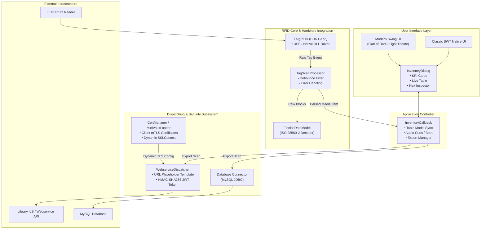
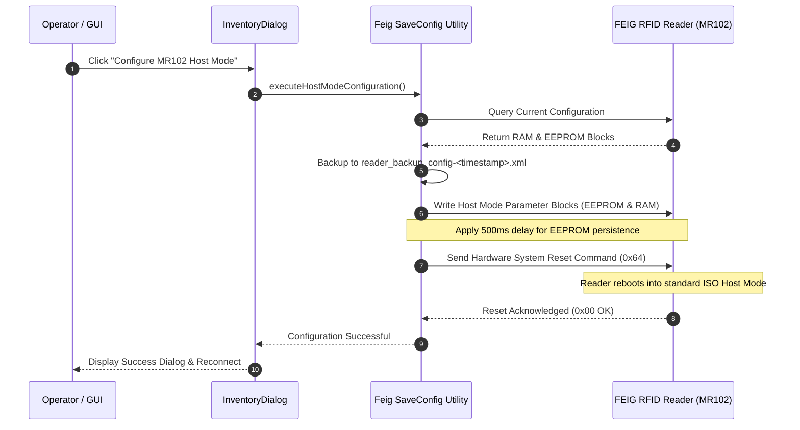

# RFID Inventory - info-age GmbH, Basel

**RFID Inventory** is a high-performance desktop application for mass-reading, verifying, and cataloging ISO 15693 RFID tags compliant with the ISO 28560-2 library standard ("Finnish Data Model"). It provides real-time verification of media signatures, relational database logging, RESTful webservice dispatching, and CSV exporting.

## License & Provenance
* **Maintainer / Copyright**: Copyright 2015-2026 info-age GmbH, Basel.
* **Original System**: Based on HAWK RFID Library Tools (Copyright 2015 Center for Information, Media and Technology (ZIMT), HAWK University of Applied Sciences and Arts Hildesheim/Holzminden/Göttingen).
* **License**: GNU General Public License v3 or later (GPLv3+).

---

## Features & Highlights

* **Dual User Interface**:
  * **Modern Swing / FlatLaf**: High-DPI scaling, automatic Dark/Light theme support, live search filtering, KPI metrics summary cards, tag inspector, and hex dump analysis.
  * **Classic SWT**: Native Windows standard interface for low-footprint legacy environments.
  * Configurable via `inventory.xml` (`<ui>modern</ui>` or `<ui>swt</ui>`).
* **Hardware Integration**:
  * Direct integration with FEIG RFID readers using the FEIG SDK Gen3 (`v7.1.0`) with 64-bit native driver support (`lib/native/x64/`).
  * Automatic USB reader detection, real-time connection status monitoring, and reader diagnostic logs.
* **Flexible Data Dispatching & Client TLS**:
  * **Local Processing**: Immediate tag validation and in-memory session logging.
  * **Relational Database**: Logging and querying via MySQL/MariaDB JDBC driver (`com.mysql.cj.jdbc.Driver`).
  * **HTTP / REST Webservice**: Real-time dispatching of scan payloads with optional HMAC-SHA256 JWT authorization tokens.
  * **Client TLS / mTLS**: Seamless integration with `certmanager` for automated MiniVault certificate rotation.
* **Firmware & Reader Configuration Tools**:
  * Direct GUI integration: Dedicated **MR102 Host-Mode** button in the toolbar to configure the reader in standard ISO Host Mode, including EEPROM write delays, automatic hardware system reset, and optional configuration backups.
  * Built-in scripts (`backup-firmware.ps1`, `restore-firmware.ps1`) to backup and restore full EEPROM/RAM hardware parameter sets.
* **Packaging & Deployment**:
  * Self-contained Windows runtime packaging via `jpackage`.
  * Single-file executable installer generated via Inno Setup 6 (`build-installer.ps1`).

---

## Application Architecture



---

## FEIG Reader Configuration & Host-Mode Sequence



---

## Directory & File Structure

```
rfid-inventory/
├── app.ico / app.png / background.jpg  # Application icons and branding assets
├── backup-firmware.ps1                  # PowerShell script to backup reader firmware config
├── build-installer.ps1                  # PowerShell script to build installer & portable bundle
├── installer.iss                        # Inno Setup 6 script
├── installer-messages.iss               # Multi-language installer strings (English & German)
├── inventory.xml.template               # Template configuration file
├── inventory.xml                        # Local configuration file (gitignored)
├── pom.xml                              # Submodule Maven POM
├── readme.md                            # Module documentation
├── reader_host_mode_config.xml          # Reference host-mode configuration for FEIG MR102
├── restore-firmware.ps1                 # PowerShell script to restore reader firmware config
├── run-inventory.ps1                    # Application startup script for development
├── scripts/                             # Pascal helper scripts for Inno Setup installer
│   ├── version-check.pas
│   ├── wizard-pages.pas
│   └── xml-config.pas
└── src/
    ├── main/java/                       # Java application source code
    │   └── org/objectspace/rfid/
    │       ├── FinnishDataModel.java    # ISO 28560-2 encoder/decoder
    │       ├── feig/                    # FEIG SDK wrapper & SaveConfig utility
    │       ├── library/inventory/       # UI (Modern/SWT), callback & data models
    │       └── webservice/              # REST client, JWT generator & URL builder
    ├── main/resources/                  # Vector icons & logback configuration
    └── test/java/                       # JUnit 5 test suite & TestRunner
```

---

## Prerequisites

* **Operating System**: Windows 10 / 11 (x64)
* **Java Development Kit**: JDK 25 or later (with `JAVA_HOME` configured)
* **FEIG SDK Gen3**: Bundled under `../lib/` (Java APIs and `lib/native/x64/` DLLs)
* **Inno Setup 6** (optional): Required only for building the Windows `.exe` setup installer

---

## Getting Started

### 1. Configuration (`inventory.xml`)

```xml
<configuration>
    <!-- Selection of user interface: "modern" (FlatLaf Swing) or "swt" (Classic SWT) -->
    <inventory>
        <ui>modern</ui>
        <theme>system</theme>
        <sleep>300</sleep>
    </inventory>

    <!-- RFID Reader Settings -->
    <device>
        <select>feig</select>
        <feig>
            <type>usb</type>
        </feig>
    </device>

    <!-- Optional REST Webservice Integration -->
    <webservice>
        <active>true</active>
        <client_id>1</client_id>
        <target_url><![CDATA[https://inventory.example.org/api/inventory?clientid={clientid}]]></target_url>
        <http_method>POST</http_method>
        <jwt_key><![CDATA[secret-jwt-key]]></jwt_key>
        <debug_mode>false</debug_mode>
    </webservice>

    <!-- Client TLS / mTLS configuration with MiniVault -->
    <clienttls>
        <type>minivault</type>
        <minivault>
            <baseurl><![CDATA[https://localhost:8759/api/v1]]></baseurl>
            <parenttoken><![CDATA[pa.22f09dfd1cbfbe9f.c17b29cb2b730533]]></parenttoken>
            <tokentype>client_cert</tokentype>
            <tokenpolicies>
                <policy>wsbroker.client</policy>
            </tokenpolicies>
            <certtype>client_cert</certtype>
            <uris>
                <uri>wsbroker:client:display01</uri>
                <uri>wsbroker:channel:all</uri>
            </uris>
            <ca>
                <path>certs/minivault.ca.pem</path>
            </ca>
            <usesystempool>false</usesystempool>
        </minivault>
    </clienttls>
</configuration>
```

### 2. Running in Development Mode

Run the PowerShell launcher script:

```powershell
.\run-inventory.ps1
```

Options:
* `-Rebuild`: Forces recompilation of all Java classes before launch.
* `-NoPause`: Disables the interactive key press on exit (useful for scripts and CI).
* `-JavaArgs @("-Xmx512m")`: Passes extra JVM parameters.

---

## Building the Windows Installer

To build the self-contained portable distribution and the Inno Setup installer:

```powershell
.\build-installer.ps1 -AppVersion "1.0.6"
```

Output:
* **Installer Setup**: `dist\RFID-Inventory-Setup-1.0.6.exe`
* **Portable Runtime**: `target\dist\RFID-Inventory\`

---

## Firmware & Reader Configuration Tools

The module includes automation scripts to read and write complete EEPROM and RAM hardware configuration blocks from connected FEIG RFID readers.

### 1. Reader Backup (`backup-firmware.ps1`)

Reads the full hardware parameter set from the connected reader and saves it to an XML backup file.

```powershell
# Default backup (creates reader_backup_config-<timestamp>.xml)
.\backup-firmware.ps1

# Custom output file
.\backup-firmware.ps1 -OutputFile "my_reader_backup.xml"

# Specify device ID and skip pause
.\backup-firmware.ps1 -DeviceId "1F1610A4" -NoPause
```

### 2. Reader Restore (`restore-firmware.ps1`)

Restores an XML parameter file to the reader's EEPROM and RAM.

```powershell
# Interactively restores latest backup file
.\restore-firmware.ps1

# Restore specific configuration file
.\restore-firmware.ps1 -InputFile "reader_backup_config-20261009.xml"

# Force restore without interactive prompt (for automation / CI)
.\restore-firmware.ps1 -InputFile "reader_backup_config.xml" -Force -NoPause
```

---

## Testing

Run tests through Maven or the standalone test runner:

```powershell
# Run standalone TestRunner
java -cp "target\classes;target\test-classes;..\lib\*;..\lib\ext\*" org.objectspace.rfid.TestRunner
```
