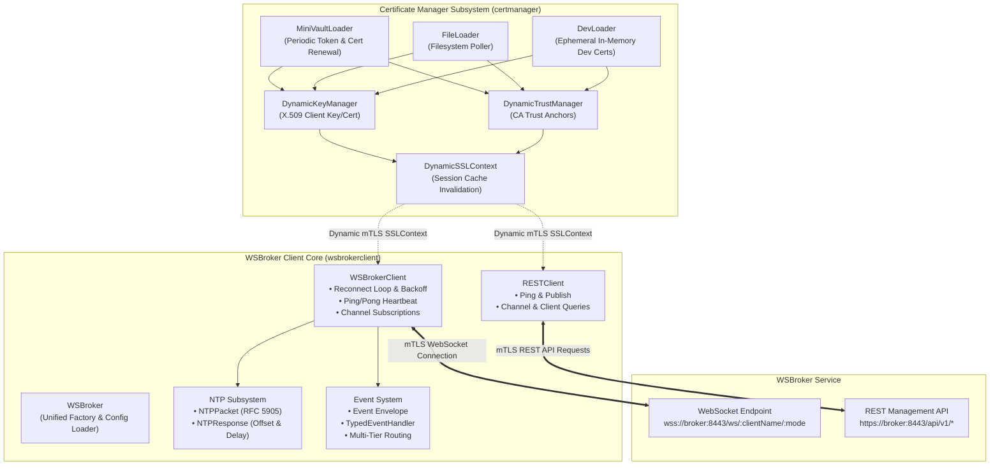
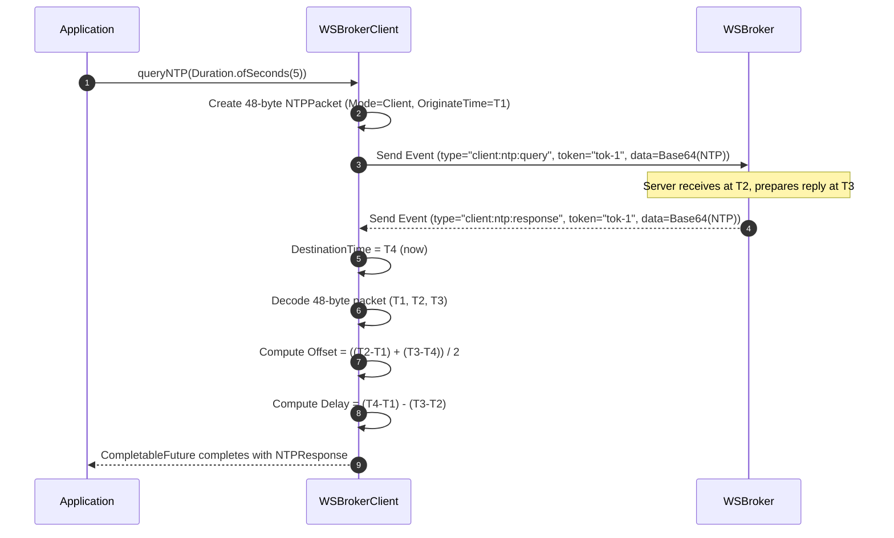
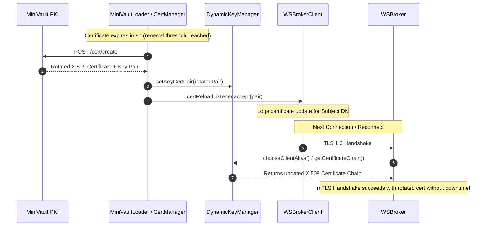
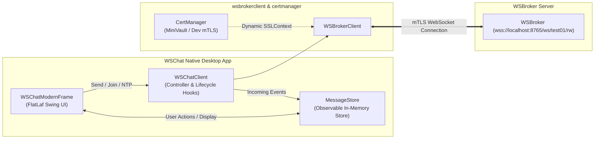

# WSBroker Client (`wsbrokerclient`)

The **WSBroker Client** (`wsbrokerclient`) module is a modern, high-throughput, zero-downtime WebSocket, REST, and NTP client library in Java for the [WSBroker](https://go.ub.unibas.ch/cloud/wsbroker) event routing ecosystem.

It provides a robust Java implementation mirroring the Go [`wsbrokerclient`](https://go.ub.unibas.ch/cloud/wsbrokerclient) library, fully integrated with [`certmanager`](../certmanager/readme.md) for dynamic mutual TLS (mTLS) certificate management, token lifecycle tracking, and runtime certificate hot-reloading.

---

## Key Features

1. **Robust Asynchronous WebSocket Client (`WSBrokerClient`)**:
   - Built on native Java `HttpClient` & `WebSocket` (Java 21/25+ standard library).
   - Thread-safe, non-blocking asynchronous event dispatching.
   - Automatic reconnect with exponential backoff and jitter.
   - Automated heartbeat monitoring (periodic ping and auto-reply pong).
   - Channel-based pub/sub, target routing, and remote action invocations.

2. **Zero-Downtime Dynamic mTLS Integration (`certmanager`)**:
   - Uses `CertLoader` (`MiniVaultLoader`, `FileLoader`, `EnvLoader`, `DevLoader`) from `certmanager`.
   - Dynamic certificate hot-reloading: rotates client X.509 certificates and CA trust anchors without JVM restart or reconnect downtime.
   - Automatic TLS session cache invalidation on certificate renewal.

3. **NTP over WebSocket Time Synchronization (`NTPPacket` & `NTPResponse`)**:
   - RFC 5905 compliant 48-byte NTP packet encoding and decoding over WebSocket text frames.
   - High-precision clock offset ($\theta$) and round-trip delay ($\delta$) calculation.
   - Asynchronous future-based query interface (`queryNTP(timeout)`).

4. **REST Management & Publishing API (`RESTClient`)**:
   - Dispatches events directly through HTTP REST endpoints (`/api/v1/publish`, `/api/v1/channel/:name/publish`).
   - Query active channels, connected clients, and channel subscriber lists.
   - Administrative remote client disconnection.

5. **Type-Safe Event Serialization & Handlers**:
   - Strongly-typed `Event` envelopes with Jackson JSON payload binding.
   - Multi-tier handler routing: global handlers, event-type handlers, channel handlers, and action handlers.

---

## Architecture Overview



---

## Sequence Flows

### 1. WebSocket Lifecycle & Event Routing

```mermaid
sequenceDiagram
    autonumber
    participant App as Application
    participant Client as WSBrokerClient
    participant CM as CertManager (mTLS)
    participant Broker as WSBroker (/ws/:client/rw)

    App->>Client: connect()
    Client->>CM: getSSLContext()
    Client->>Broker: WebSocket Handshake (mTLS / Subprotocols / Bearer)
    Broker-->>Client: 101 Switching Protocols
    Client->>Client: Transition State: CONNECTED
    Client->>Client: Start Heartbeat Ping Loop

    Note over Client,Broker: Bi-directional Event Exchange
    App->>Client: publish("rfid/gates", scanPayload)
    Client->>Broker: Text Frame: JSON Event (type="client:message")
    
    Broker->>Client: Text Frame: JSON Event (type="client:action", action="scan")
    Client->>Client: Route to matching ActionHandler
    Client-->>App: onEvent(event, data)

    Note over Client,Broker: Heartbeat & Auto-Pong
    Broker->>Client: Event (type="client:ping", token="t-987")
    Client->>Broker: Event (type="client:pong", token="t-987")
```



### 2. NTP Time Synchronization over WebSocket



### 3. Dynamic mTLS Certificate Hot-Reloading



---

## Usage Examples

### 1. Connecting with Dynamic mTLS (`certmanager`)

```java
import org.objectspace.certmanager.config.*;
import org.objectspace.wsbrokerclient.WSBroker;
import org.objectspace.wsbrokerclient.client.WSBrokerClient;
import org.objectspace.wsbrokerclient.config.WSClientConfig;
import org.objectspace.wsbrokerclient.event.EventType;

import java.time.Duration;
import java.util.List;

public class WSClientMtlsExample {
    public static void main(String[] args) throws Exception {
        // Configure MiniVault PKI loader for dynamic mTLS
        MiniVaultConfig vaultConfig = MiniVaultConfig.builder()
                .baseUrl("https://vault.example.com:8200")
                .parentToken("env:VAULT_PARENT_TOKEN")
                .tokentype("client_cert")
                .certType("client_cert")
                .dnss(List.of("rfid-scanner.local"))
                .certTtl(Duration.ofHours(24))
                .certInterval(Duration.ofHours(12))
                .build();

        CertManagerConfig certConfig = CertManagerConfig.builder()
                .type(LoaderType.MINIVAULT)
                .vault(vaultConfig)
                .tlsMinVersion("TLSv1.3")
                .build();

        // WebSocket Client Configuration
        WSClientConfig clientConfig = WSClientConfig.builder()
                .endpoint("wss://broker.example.com:8443/ws")
                .clientName("rfid-scanner-01")
                .certManagerConfig(certConfig)
                .channels(List.of("rfid/scans", "library/inventory"))
                .pingInterval(Duration.ofSeconds(20))
                .autoReconnect(true)
                .build();

        try (WSBrokerClient client = WSBroker.createClient(clientConfig)) {
            // Register event handlers
            client.onChannel("rfid/scans", event -> {
                System.out.println("Received scan event: " + event.getDataAsString());
            });

            // Connect synchronously with timeout
            client.connectSync(Duration.ofSeconds(10));

            // Publish message
            client.publish("rfid/scans", "Tag ID: E004015099887766").join();
        }
    }
}
```

---

### 2. Typed Event Handlers

```java
record BookScanPayload(String epc, String barcode, String branchId) {}

// Register strongly-typed channel listener
client.onChannel("library/books", BookScanPayload.class, (event, payload) -> {
    System.out.println("Scanned Book: " + payload.barcode() + " at branch " + payload.branchId());
});
```

---

### 3. NTP Time Synchronization over WebSocket

```java
try (WSBrokerClient client = WSBroker.createClient(config)) {
    client.connectSync(Duration.ofSeconds(10));

    // Request high-precision NTP synchronization over WebSocket
    NTPResponse ntp = client.queryNTP(Duration.ofSeconds(5)).join();

    System.out.println("Stratum: " + ntp.getStratum());
    System.out.println("Clock Offset: " + ntp.getOffsetMillis() + " ms");
    System.out.println("Round-trip Delay: " + ntp.getRoundTripDelayMillis() + " ms");
    System.out.println("Is Synchronized: " + ntp.isSynchronized());
}
```

---

### 4. WSBroker REST Management API

```java
import org.objectspace.wsbrokerclient.WSBroker;
import org.objectspace.wsbrokerclient.config.RESTConfig;
import org.objectspace.wsbrokerclient.event.Event;
import org.objectspace.wsbrokerclient.rest.ChannelInfo;
import org.objectspace.wsbrokerclient.rest.PublishResponse;
import org.objectspace.wsbrokerclient.rest.RESTClient;

import java.time.Duration;
import java.util.List;

public class RestClientExample {
    public static void main(String[] args) throws Exception {
        RESTConfig restConfig = RESTConfig.builder()
                .baseUrl("https://broker.example.com:8443")
                .bearer("secret-management-token")
                .timeout(Duration.ofSeconds(5))
                .build();

        try (RESTClient rest = WSBroker.createRestClient(restConfig)) {
            // Check health
            String ping = rest.ping();
            System.out.println("Ping: " + ping);

            // Publish event directly via REST
            Event event = Event.createMessage("admin-service", "rfid/alerts", "Gate 1 offline");
            PublishResponse pubResp = rest.publish(event);
            System.out.println("Sent: " + pubResp.isSent() + ", Subscribers: " + pubResp.getSubscribers());

            // List channels and subscribers
            List<ChannelInfo> channels = rest.getChannels();
            for (ChannelInfo info : channels) {
                System.out.println("Channel " + info.getName() + " has " + info.getSubscribers() + " subscribers: " + info.getClients());
            }

            // Disconnect a misbehaving client
            rest.disconnectClient("stale-client-99");
        }
    }
}
```

---

### 5. JSON Configuration Loading

```java
String clientJson = """
{
    "endpoint": "wss://broker.example.com:8443/ws",
    "client_name": "rfid-inventory-node",
    "subprotocols": ["v1.wsbroker.ub.unibas.ch"],
    "ping_interval": "15s",
    "reconnect_initial_delay": "1s",
    "reconnect_max_delay": "30s",
    "auto_reconnect": true,
    "channels": ["rfid/scans", "rfid/alerts"],
    "tls": {
        "type": "MINIVAULT",
        "minivault": {
            "baseurl": "https://vault.example.com:8200",
            "parenttoken": "env:VAULT_PARENT_TOKEN",
            "tokentype": "client_cert",
            "certttl": "24h"
        }
    }
}
""";

WSClientConfig config = WSBroker.loadClientConfigFromJson(clientJson);
try (WSBrokerClient client = WSBroker.createClient(config)) {
    client.connectSync(Duration.ofSeconds(10));
}
```

---

## Package Structure

- **`org.objectspace.wsbrokerclient`**
  - `WSBroker`: Unified factory entry point and configuration deserializer.
  - **`client`**:
    - `WSBrokerClient`: Core WebSocket client managing connection lifecycle, heartbeats, reconnects, mTLS, and event routing.
    - `ConnectionState`: Connection state enum (`DISCONNECTED`, `CONNECTING`, `CONNECTED`, `RECONNECTING`, `CLOSING`, `CLOSED`).
    - `ConnectionListener`: State change callback interface.
  - **`config`**:
    - `WSClientConfig`: WebSocket client configuration POJO with builder.
    - `RESTConfig`: REST client configuration POJO with builder.
    - `DurationDeserializer`: Jackson deserializer supporting Go durations (`"15s"`, `"1m"`, `"24h"`) and ISO-8601 (`"PT15S"`).
  - **`event`**:
    - `EventType`: Standard event type constants and enums (`client:message`, `client:action`, `client:ping`, `client:ntp:query`, etc.).
    - `Event`: Core JSON message envelope with builder, factory methods, and generic payload deserialization (`getDataAs(Class<T>)`, `getDataAs(TypeReference<T>)`).
    - `EventHandler` / `TypedEventHandler<T>`: Functional interfaces for event processing.
  - **`ntp`**:
    - `NTPPacket`: 48-byte RFC 5905 NTP Version 4 packet encoder and decoder.
    - `NTPResponse`: NTP calculations containing clock offset ($\theta$), round-trip delay ($\delta$), stratum, and sync status.
  - **`rest`**:
    - `RESTClient`: WSBroker REST management client using `HttpClient`.
    - `PublishRequest`, `PublishResponse`, `ChannelInfo`: Data transfer objects.
  - **`demo.wschat`**:
    - `WSChat`: Main application launcher for the native GUI demo.
    - `WSChatModernFrame`: Modern Swing + FlatLaf UI with dark/light themes, KPI cards, live channel switching, and real-time logs.
    - `WSChatClient`: Controller connecting `WSBrokerClient` with `MessageStore` and UI callbacks.
    - `WSChatConfig`: XML configuration parser supporting `wschat.xml`.
    - `MessageStore`: Thread-safe observable in-memory message and channel store.
    - `ChatMessage`: Data model for channel chat messages.

---

## Native GUI Demo Application (`WSChat`)

The `wsbrokerclient` module includes a native desktop GUI demo application (`org.objectspace.wsbrokerclient.demo.wschat.WSChat`) based on **FlatLaf Swing**, built upon the exact same modern frontend architecture as `rfid-inventory`.

### Features of the Native GUI
- **FlatLaf Modern Design System**: Responsive layout with automatic Windows / OS Dark Mode detection and live runtime theme switching.
- **KPI Metrics Cards**: Real-time status cards displaying connection state, active channel, message counters, and subscribed channels.
- **Dynamic Channel Management**: Seamlessly switch active channels and dynamically subscribe to new channels (`#all`, `#intern`, etc.) at runtime.
- **Live Search & Filter**: Real-time message filtering by keyword or sender.
- **Live Event Log & Security Inspector**: Real-time console displaying raw WebSocket frames, NTP latency measurements, and dynamic mTLS certificate metadata from `certmanager`.
- **XML Configuration (`wschat.xml`)**: Configured via XML directly corresponding to the Go `wschat.toml` format.



### Launching the Native GUI Demo
```bash
# Run with default wschat.xml configuration
java -cp target/wsbrokerclient-2.0.0-SNAPSHOT.jar org.objectspace.wsbrokerclient.demo.wschat.WSChat

# Or supply custom XML configuration path
java -cp target/wsbrokerclient-2.0.0-SNAPSHOT.jar org.objectspace.wsbrokerclient.demo.wschat.WSChat path/to/wschat.xml
```
